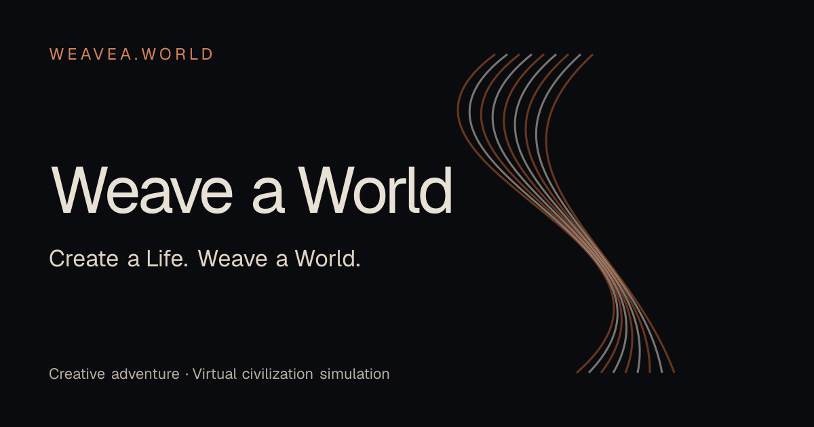

<div align="center">

# Weave a World · 织个世界

**Create a Life. Weave a World.**

A creative adventure and civilization simulator in development.
Create characters and equipment, put them to the test, and shape the world's story.

[Website](https://weavea.world) · [中文说明](README.zh.md) · [Run locally](#run-locally) · [Agent integration](#create-with-an-agent) · [Documentation](#documentation)



</div>

## The idea

**Your creations change the world.**

Design a weapon, build a character, or ask an agent to help express an idea. Bring
that creation into a game, see how it performs, and use what happens to improve
the next version. The loop we are building toward is:

**Create → Play → Observe → Improve → Leave a mark on the world.**

The repository currently contains playable defense games, a negotiation game,
and an autonomous world prototype. A shared, evolving civilization is the
longer-term direction; creations do not yet travel freely between these games.

## What you can explore today

| Experience | What you do | Entry and current scope |
| --- | --- | --- |
| **Doodle Siege** | Draw or assemble weapons, test their physical behavior, and defend a castle through a campaign. | `/{workspaceSlug}/siege` and `/{workspaceSlug}/siege/campaign`. Uses the main Web/Desktop application and account. |
| **Tank Defense** | Build a tank from budgeted parts, then drive and shoot through campaign, blitz, or survival modes. | `/{workspaceSlug}/tanks`. Web/Desktop; keyboard and browser touch controls. External agents can create tanks through MCP. |
| **Personal collection** | Revisit your Siege blueprints, Tank characters, and personal progress. | `/{workspaceSlug}/me`. Scoped to your account and workspace; personal records are client-reported. |
| **REACH world preview** | Watch autonomous entities compete for supplies, fight, and leave wrecks. Submit creations through its HTTP API. | Public homepage preview plus a separate experimental world service. The homepage labels live, preview, and disconnected states. The browser creation flow is still pending. |
| **DEAL** | Negotiate with a debt collector using conversation, evidence, and objects in the room. | Standalone `/deal`, started separately. Supports an explicitly selected rule practice mode or a configured language model. |

For Siege and Tanks, sign in at the local Web address, complete onboarding, and
open the game from the workspace sidebar. Ordinary defense gameplay needs no
model configuration. Siege also supports manual part confirmation without AI
recognition. Native mobile game integration is not implemented.

## Create with an agent

People and agents should be able to create for the same game. Agents produce
structured drafts; versioned catalogs and deterministic rules validate them and
derive gameplay attributes.

**Tank creation is the implemented MCP path:** read the catalog → validate a
draft → save a character revision → check compatibility → create a frozen
session → open its `playUrl` and play. The agent helps create the tank; the
player drives it. Start with the in-game **Connect Agent** action and the
[Tank MCP guide](docs/tank-character-mcp.md).

The current contracts have distinct scopes:

| Contract | Status |
| --- | --- |
| `tank-defense@1` | Implemented Tank character catalog, HTTP API, MCP, and frozen sessions. |
| `reach.entity/1` | Experimental REACH entity submission and world rules; separate from Tank characters. |
| `ground2d@1` | Proposed general assembly contract. The [design specification](docs/character-game-api.md) is not an implemented API. |

Client configuration and authentication depend on the MCP client. See the
[connection guide](docs/codex-mcp-deployment.md) for setup and validation scope.

## Run locally

Run commands from the repository root unless stated otherwise.

### Main application: Siege, Tanks, and your collection

Prerequisites:

- Node.js satisfying the root [package.json](package.json) `engines` field.
- The exact pnpm version in its `packageManager` field.
- Go as declared in [server/go.mod](server/go.mod).
- A running PostgreSQL 17+ service with `psql`, `pgcrypto`, and `pg_trgm` available.

For a new main checkout, copy the example once and configure `DATABASE_URL` in
`.env` for an existing PostgreSQL login role:

```bash
cp .env.example .env
```

Then install and start:

```bash
pnpm install --frozen-lockfile
make up MODE=development
make status
```

Open the Web address reported by `make status`. The managed environment assigns
ports and a database to this checkout, runs migrations, and starts the API and
Web. A missing local database can be created when the configured role has
permission; remote databases must already exist. Docker PostgreSQL is optional
via `make db-up`.

```bash
make up MODE=production    # Daily local use; builds and reuses .next-local
make up MODE=development   # Hot reload for editing
make status                # Addresses, component status, and selected Web mode
make down                  # Stop this environment and keep its data
```

The selected Web mode is remembered per checkout. For a Git worktree, generate
its `.env.worktree` with `make worktree-env`; do not copy the main checkout's
`.env`. See [Make commands](docs/make-commands.md) and [scripts/dev-env.sh](scripts/dev-env.sh)
for environment management.

### DEAL: standalone practice

DEAL needs Node.js, pnpm, and Go, and runs without a workspace account or
PostgreSQL:

```bash
pnpm install --frozen-lockfile --filter @auro/deal...
DEAL_MODEL_MODE=scripted make up C=deal
make status C=deal
make down C=deal
```

The default Web address is `http://127.0.0.1:13106/deal/`. Sessions and logs live
in `.deal/`. For model-backed play, configure `DEAL_MODEL_MODE=llm` and
`DEAL_LLM_*` using [.env.example](.env.example), then restart DEAL. Model failure
does not silently switch to rule practice. See [DEAL setup and delivery](docs/deal-delivery.md).

### REACH: experimental world service

REACH currently has its own single-instance, file-backed service. It is not
started by the main application's `make up`:

```bash
cd server
REACH_DATA_DIR=.reach REACH_SEED=42 REACH_BEAT_SECONDS=1 go run ./cmd/reach
```

The API defaults to `http://127.0.0.1:18107`; discover it at
`/.well-known/reach.json`. One-second beats are for local demonstrations; the
default is 60 seconds. Stop the foreground service with Ctrl+C.

The homepage uses same-origin `/api/reach` requests by default. Showing this
service's live world requires routing `/api/reach/*` and
`/.well-known/reach.json` to it; starting the service alone does not connect the
homepage. Without a live connection, the homepage can show labeled preview
data. See the [REACH design and implementation notes](docs/reach-world-prd.md)
for endpoints and remaining work, including season archival and creator pages.

## Architecture

| Location | Responsibility |
| --- | --- |
| `apps/web` | Next.js public game pages and authenticated workspace routes. |
| `apps/desktop` | Electron host using the shared game views and logic. |
| `packages/core` | Headless game rules, catalogs, schemas, API clients, and shared state. |
| `packages/views` | Shared game screens, Canvas rendering, physics, input, and audio. |
| `packages/ui` | Shared UI primitives and semantic styles. |
| `server/internal/siege`, `tanks`, `gameprogress` | Main application game APIs, saved creations, and personal progress. |
| `apps/deal`, `server/internal/deal` | Standalone negotiation game. |
| `server/internal/reach`, `server/cmd/reach` | Experimental autonomous world engine, HTTP API, and service. |
| `apps/mobile` | Independent Expo/React Native client; game integration is pending. |

The project builds on Auro's account, workspace, agent, and runtime
infrastructure. Internal `@auro/*` package names and `AURO_*` configuration remain
in use. Issue, project, my-issues, and squad UI routes are retired; chat is the
current workspace landing page.

## Verification

Choose checks for the affected game; detailed commands live in its guide.
The main frontend and backend checks are:

```bash
pnpm typecheck
pnpm lint
pnpm test
make test
```

Authenticated game browser tests run against an explicitly started main
application:

```bash
pnpm exec playwright test e2e/siege e2e/tanks.spec.ts e2e/tanks-mcp.spec.ts
```

DEAL has its own [checks and Playwright configuration](docs/deal-delivery.md).
REACH's Go tests run with `(cd server && go test ./internal/reach)`.
Root frontend checks exclude native mobile; see its [README](apps/mobile/README.md)
and [agent instructions](apps/mobile/AGENTS.md).

## Documentation

| Topic | Guide |
| --- | --- |
| Brand and public website | [Brand and search identity](docs/brand-and-seo.md) |
| Local environment | [Make commands](docs/make-commands.md) |
| Siege workshop and campaign | [Integration](docs/siege-integration-plan.md) · [Campaign](docs/siege-campaign-delivery.md) |
| Tank rules and controls | [Tank Defense](docs/tank-defense.md) |
| Agent-created tanks | [Tank MCP](docs/tank-character-mcp.md) · [Client setup](docs/codex-mcp-deployment.md) |
| Autonomous world direction | [REACH PRD and prototype status](docs/reach-world-prd.md) |
| Negotiation game | [DEAL PRD](docs/deal-prd.md) · [Setup and delivery](docs/deal-delivery.md) |
| Proposed general character protocol | [Design specification](docs/character-game-api.md) |
| Repository contribution rules | [AGENTS.md](AGENTS.md) |

Design documents may describe work beyond the current implementation. Use their
implementation notes and the owning source code to determine availability.

## License and attribution

This repository contains code derived from Auro. The existing
[Auro License](LICENSE) and [attribution notice](NOTICE) remain applicable;
consult those files for the terms.
