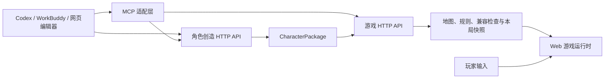
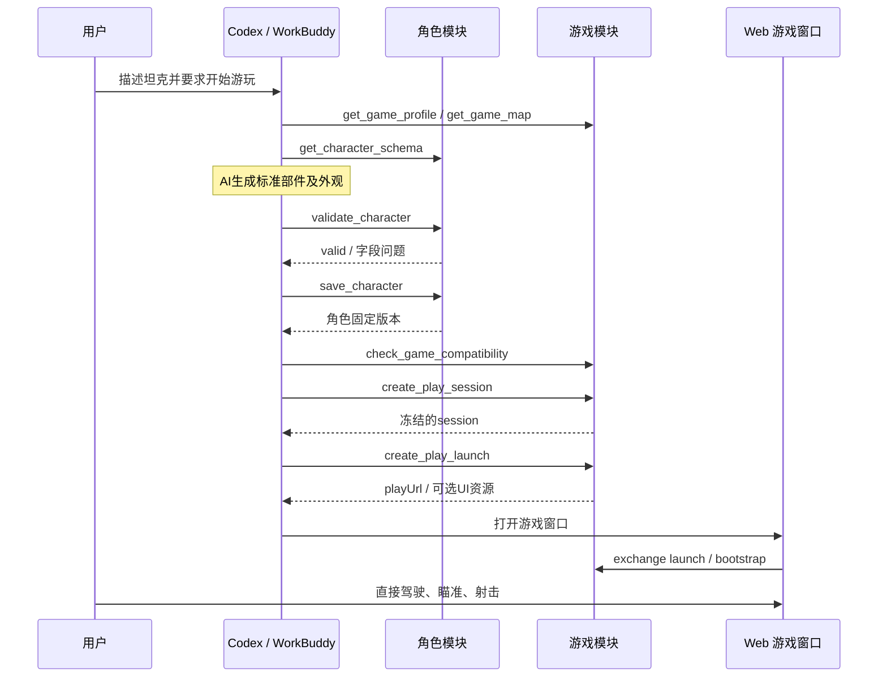

# 角色创造与游戏对接接口技术规范 v1

日期：2026-10-23。契约版本：`1.0.0-draft.1`。

本文是 `ground2d@1` 通用自由拼装角色的设计规范，尚未整体实现；示例域名使用 `.invalid`，不能用于真实请求。**现有经典坦克游戏已经实现独立的 `tank-defense@1` HTTP / MCP 接口**，接入、真实字段与案例见 [坦克角色 MCP](tank-character-mcp.md)。两种 profile 的草稿不可混用。现有 `/api/siege` 绘图识别、蓝图和战役接口不因本文而改变。

## 1. 交付物与阅读顺序

| 文件 | 用途 |
| --- | --- |
| 本文 | 模块边界、字段语义、调用顺序、错误与验收 |
| [openapi.json](character-game-api/openapi.json) | HTTP API 的 OpenAPI 3.1 定义；`components.schemas` 是字段、必填项、枚举和范围的权威来源 |
| [mcp-tools.json](character-game-api/mcp-tools.json) | MCP `tools/list` 的工具清单，包含完整展开的 `inputSchema`、`outputSchema` 和 HTTP 映射 |
| [example-index.json](character-game-api/example-index.json) | JSON 案例与对应 Schema、operationId 的索引 |
| [examples/](character-game-api/examples/) | 坦克、固定火炮、创建、改装、地图、游戏启动、MCP 和失败案例 |

接口模型采用 JSON Schema 2020-12。本文解释跨字段约束和状态规则，OpenAPI 负责机器可读格式；二者必须同时满足。示例不是省略字段的伪 JSON，文件可直接用于格式校验。

## 2. 模块与依赖



| 模块 | 负责 | 交付边界 |
| --- | --- | --- |
| 角色创造 | 内容规范、部件、外观资源、结构校验、角色库、不可变版本 | 接受 `CharacterDraft`，交付 `CharacterPackage` |
| 游戏 | 地图、玩法规则、角色适配、出生检查、会话、战斗和结算 | 接受固定角色版本，交付本局 `PlayBootstrap` |
| MCP 适配层 | 将两个模块的 API 暴露给 Codex、WorkBuddy | 不另写角色规则或游戏规则 |
| 宿主 | 认证、workspace 选择、浏览器窗口、资源缓存和本地进度 | 通过平台适配注入；角色内容不记录宿主会话 |

角色创造模块不导入 Siege 地图或 Rapier。游戏模块读取角色协议，不依赖角色来自哪个模型、哪个客户端或哪个编辑器。两个模块可以先同进程部署，再独立部署；不要求新增通用 ECS 或重写现有游戏引擎。

v1 支持 `ground2d@1` 内容规范下的 `tracked-tank@1`（履带坦克）和 `fixed-turret@1`（可操作固定火炮）。二者都交付完整、可操作的角色；炮管等部件在创造时内联到角色包。独立可插拔武器依赖、飞行、步行机器人、3D、任意脚本和多人同步不属于 v1。

角色可以由 Codex / WorkBuddy 的模型及可用作图工具生成，也可以由网页编辑器创建。v1 的提交协议接受标准数据与资源；不强制再调用一遍服务端模型。未来的一键生成服务也必须交付相同 `CharacterDraft`，不改变游戏接口。

## 3. HTTP 共同约定

### 3.1 地址、认证与作用域

- 角色模块前缀：`/api/characters/v1`。
- 游戏模块前缀：`/api/games/v1`。
- JSON 请求使用 `Content-Type: application/json`，编码为 UTF-8。
- 对象 ID 使用 UUID；资源路径中的 `gameId`、`mapId` 是小写标识符。
- 时间使用带 `Z` 的 UTC RFC 3339 字符串。文档示例 `2026-10-23T04:00:00Z` 对应北京时间 12:00。
- 用户接口使用 `Authorization: Bearer <user-access-token>` 和 `X-Workspace-ID: <uuid>`。Auro 浏览器宿主使用已有 `auro_auth` Cookie；所有 Cookie 认证的 POST 另需宿主 `X-CSRF-Token`。独立部署通过认证适配提供自己的会话，并在部署说明中声明 Cookie 名。
- `X-Workspace-ID` 只选择上下文，不授予权限。服务端校验 workspace 成员、资源所有者和 Token 限制；Token 已固定 workspace 时，客户端不能覆盖。独立部署由认证适配层提供等价租户上下文。
- `CharacterDraft` / `CharacterPackage.content` 不包含 workspace、用户 Token、游戏会话、地图 ID 或机器本地路径。

| scope | 允许的操作 |
| --- | --- |
| `characters:read` | 读取规范、校验、读取自己的角色库与版本 |
| `characters:write` | 上传资源、创建角色、追加版本 |
| `games:read` | 读取游戏、地图、兼容检查、自己的会话元数据 |
| `games:play` | 创建本局及短时启动入口 |
| `game:bootstrap` | 只读取被游戏 Token 绑定的本局冻结内容与资源 |

OAuth 授权流程复用宿主身份系统，MCP 认证状态由连接器管理。不能把 Codex 的登录态当作游戏账号，也不能自动复用 WorkBuddy 的账号 Cookie。

### 3.2 重试、幂等与版本

创建上传、确认上传、保存角色、追加版本、创建游戏会话、创建启动入口和兑换启动码，都要求 `Idempotency-Key: <uuid>`。

幂等范围为认证主体、workspace、HTTP 方法、路径和幂等键；指纹覆盖规范化请求体。相同键和内容返回第一次完成时的状态码及响应，不能重复新增版本或会话。相同键更换内容返回 `409 idempotency_key_reused`。处理中返回 `409 request_in_progress` 及 `Retry-After`；相同键可继续查询式重试。

普通幂等记录保留至少 24 小时。启动码兑换使用第 9 节的 60 秒重试窗口，不长期保存可重放的游戏凭证。网络中断时先复用原键；用户决定再次独立执行时使用新键。不要用新键无条件重试结果未知的创建请求。

角色首次保存产生 revision 1。追加版本请求中的 `expectedRevision` 必须等于最新 revision；检查、追加版本和幂等回执在同一原子操作内完成。版本不匹配返回 409，不自动覆盖或自动合并。

### 3.3 严格输入与兼容读取

请求体、角色内容及能力定义不接受未声明字段。协议未支持的行为返回明确错误，不能悄悄变成普通火炮或预设角色。

响应信封允许新增可选元数据，客户端忽略未知响应元数据；Web/Desktop 使用 zod 和 `parseWithFallback`。列表中的未知状态可以显示为“暂不支持”，但未知角色内容版本、能力、规则或编译器版本必须阻止部署。不能用宽松反序列化绕过角色内容校验。

新格式、能力语义、坐标定义或默认规则变化，需要新的内容规范 / 规则版本。`schemaVersion`、`profile`、`revision`、`rulesVersion`、`compilerVersion` 各自独立，不能互相代替。

## 4. 标准角色包

### 4.1 草稿和不可变版本

| `CharacterDraft` 字段 | 类型 / 必填 | 含义 |
| --- | --- | --- |
| `format` | 固定字符串 `auro.character` | 内容格式 |
| `schemaVersion` | 整数 `1` | 包格式版本 |
| `profile` | 固定字符串 `ground2d@1` | 部件与能力语义版本 |
| `name` | 字符串，1–80 字符 | 可见名称；不得全为空白 |
| `definition` | `CharacterDefinition` | 部件、移动、防护和武器定义 |
| `assets` | `AssetDescriptor[]`，0–16 项 | 所有外部贴图的资源清单；参数化外观可为空 |

| `CharacterPackage` 字段 | 含义 |
| --- | --- |
| `characterId` | 服务端分配的角色 UUID |
| `revision` | 从 1 递增的不可变版本 |
| `contentHash` | 服务端对规范化 `content` 计算的 SHA-256 |
| `createdAt` | 该版本的创建时间 |
| `requires` | 服务端从内容推导的能力集合，按字符串升序排列 |
| `content` | 完整 `CharacterDraft` |

客户端提交草稿，不填写可信版本、哈希和能力声明。读取、校验和游戏装载时，都重新验证跨字段关系；保存时不会仅凭一次早先的校验报告放行。

角色引用必须同时携带 ID、revision 和哈希，禁止用 `latest` 开局：

```json
{
  "characterId": "11111111-1111-4111-8111-111111111111",
  "revision": 1,
  "contentHash": "c7c8bdd167bd53cbaa0bf1efadbb126e7b77608a37a8c5585415c1e7feca5eac"
}
```

完整案例：[坦克草稿](character-game-api/examples/tank.draft.json)、[坦克版本包](character-game-api/examples/tank.package.json)、[固定火炮草稿](character-game-api/examples/fixed-turret.draft.json)。两份草稿采用参数化图形，`assets: []`，不依赖不存在的贴图文件。

### 4.2 部件、坐标和武器

设计和地图坐标统一使用整数毫米；运行时只在边界转换为米。正 X 向右，正 Y 向下；局部正 X 是部件默认前方。旋转 `rotationMdeg` 使用千分之一度，正值沿屏幕顺时针；90° 为 90000。运行时转换为弧度。

每个部件包含：

```ts
interface Part {
  id: string;
  parentId: string | null;
  role: "hull" | "base" | "turret" | "barrel" | "track" | "decoration";
  transform: {
    positionMm: { x: number; y: number };
    rotationMdeg: number;
  };
  geometry:
    | { type: "box"; lengthMm: number; widthMm: number }
    | { type: "circle"; radiusMm: number }
    | { type: "polygon"; verticesMm: Array<{ x: number; y: number }> };
  visual:
    | { type: "primitive"; fill: string; stroke: string; strokeWidthMm: number }
    | { type: "sprite"; assetId: string; pivotPermille: { x: number; y: number } };
}
```

TypeScript 用于解释结构；整数、枚举和范围以 OpenAPI Schema 为准。

- 部件的局部原点是旋转锚点。`transform` 将局部原点定位到父部件坐标系；根部件定位在角色坐标系。
- box 以局部原点为中心，`lengthMm` 沿 X，`widthMm` 沿 Y；circle 以原点为圆心；polygon 隐式闭合，不重复最后一个点，不允许自交。
- 只允许一个 `parentId: null` 的根，其 positionMm 为 `{x:0,y:0}`、rotationMdeg 为 0；其余引用必须存在，不能循环、重复 ID 或形成脱离根的装配。parts 数组顺序是绘制层序，父子坐标通过 ID 解析。
- 坦克根角色为 `hull`，具有两条 `track`、一个 `turret` 和一个 `barrel`；移动类型必须为 `tracked`。固定火炮根为 `base`，移动类型必须为 `static`。
- hull/base 和 track 使用 box；turret 使用 circle；barrel 使用 box。polygon 在 v1 仅用于 decoration，且须为简单凸多边形，最多 16 顶点。
- 炮塔挂在 hull/base 上，炮管挂在炮塔上。底盘与炮塔独立旋转；挂点关系不能从图片像素猜测。
- `sprite` 的 `pivotPermille` 使用 0–1000 整数，`{x:500,y:500}` 表示图像中心；贴图按 geometry 包围盒缩放，保持其宽高比例，透明边距计入可见对齐检查。元数据中的像素宽高必须与实际文件一致。

`definition.mobility` 为 `{type:"tracked",engineTier:1|2|3}` 或 `{type:"static"}`。`protection` 指定 steel/wood 与 1–3 级防护。v1 每个角色恰有一门 cannon；`weapons[0]` 引用炮塔和炮管部件，指定 50/75/100 mm 口径及 `solid` 弹药。

`muzzle` 采用炮管局部坐标。炮管必须长 1600–3200 mm、宽 450–1050 mm；炮口位置为正 X 前端 `{x:lengthMm/2,y:0}`，方向 `rotationMdeg:0`。尺寸为奇数导致半毫米炮口时拒绝草稿；v1 炮管尺寸要求 50 mm 步进。例中炮管中心在炮塔前方 800 mm，炮口在炮管局部前方 800 mm，总计在炮塔前方 1600 mm。

移动阻挡体由 hull/base 与 track 的整体包络生成；track 只作为底盘的一部分，不为每片履带创建刚体。炮塔、炮管负责瞄准与射击，不创建用于阻挡车体移动的附加碰撞体。发射必须检查炮口到初始弹丸位置的地形阻挡，实际弹丸使用 CCD；不能隔墙从另一侧生成炮弹。

### 4.3 校验层次和预算

1. JSON 格式：类型、字段、整数范围、枚举和版本。
2. 角色结构：父子关系、根、部件角色、炮口、资源引用及尺寸。
3. 内容预算：最多 16 部件、16 贴图、24 碰撞体、2 刚体、1 关节；单图不超过 4 MiB 和 2048×2048，总资源不超过 16 MiB，全角色扫掠包络直径不超过 6000 mm，包含装饰以及炮塔/炮管旋转范围。
4. 游戏兼容：地图支持的能力、角色类型、玩法、规则和出生区域。
5. 本地装载：复核资源哈希、冻结版本和实时空间占用，再实例化物理世界。

预算是规范上限，不代表已经完成低端设备性能验收。当前两个 archetype 的底盘预计使用一个碰撞体和一个刚体；新增机制必须重新定义规范，不能仅因总预算尚有余量就执行任意关节结构。

AI 不直接提交质量、速度、HP、伤害、射程、装填、造价或可执行脚本。这些值由游戏模块按 `rulesVersion` 和 `compilerVersion` 推导；同一角色可进入多个兼容地图，地图与游戏决定玩法和数值。

### 4.4 内容哈希

`contentHash` 仅覆盖 `CharacterPackage.content`，不覆盖角色 ID、revision、时间、`requires` 或临时下载地址。算法为 SHA-256，输出 64 个小写十六进制字符。

规范化过程：

1. 解析 JSON，拒绝重复键、无效 UTF-8、孤立代理字符和非有限数值。
2. 校验所有内容字段；所有数字必须为安全整数。把整数表示统一为十进制整数，`-0` / `0.0` 统一为 `0`。
3. 递归将对象键按 ASCII 升序排序；协议字段键均为 ASCII，数组保持原顺序。
4. JSON 不含缩进或分隔空白；非 ASCII 字符直接使用 UTF-8，不做 Unicode 规范化；仅转义引号、反斜线及 U+0000–001F 控制字符。控制字符优先使用 `\b`、`\t`、`\n`、`\f`、`\r`，其余用小写 `\u00xx`；不转义 `/`。
5. 对无 BOM、无结尾换行的字节计算哈希。下载文件为了可读性可以有缩进；不能直接对可读 JSON 文件字节计算 `contentHash`。

[规范化测试向量](character-game-api/examples/canonical-hash-vector.json)给出精确规范化文本与哈希。资源自身的 SHA-256 覆盖原始文件字节，不使用此 JSON 规范化算法。资源清单按 `assetId` 升序，能力集合按字符串升序；部件顺序保留并参与哈希。

## 5. 角色创造 HTTP API

| 方法 | 路径（前缀 `/api/characters/v1`） | operationId / 成功响应 |
| --- | --- | --- |
| GET | `/profiles/{profileId}` | `getCharacterSchema` → 200 `CharacterProfile` |
| POST | `/asset-uploads` | `createCharacterAssetUpload` → 201 `UploadTicket` |
| POST | `/asset-uploads/{uploadId}/complete` | `completeCharacterAssetUpload` → 201 `AssetDescriptor` |
| POST | `/validations` | `validateCharacter` → 200 `ValidationReport` |
| POST | `/packages` | `saveCharacter` → 201 `CharacterPackage` |
| GET | `/packages?limit=20&cursor=...` | `listCharacters` → 200 `CharacterList` |
| POST | `/packages/{characterId}/revisions` | `createCharacterRevision` → 201 `CharacterPackage` |
| GET | `/packages/{characterId}/revisions/{revision}` | `getCharacter` → 200 `CharacterPackage` |

### 5.1 读取规范

`GET /api/characters/v1/profiles/ground2d@1` 返回可用 archetype、能力、预算、`semanticRules` 和 `draftSchema`，见[完整规范响应](character-game-api/examples/character.profile.json)。draftSchema 是完整展开、无需访问外部 `$ref` 的 JSON Schema；semanticRules 描述连接关系、根坐标、炮管尺寸等跨字段规则。创建端同时遵循两者，而不是自行猜字段。

角色创造只接收 `profile`；不要求创建者先持有游戏会话或选择地图。希望针对某个游戏创建时，客户端先读取该游戏 profile，再选择兼容的角色 profile。

### 5.2 贴图上传

上传顺序是“申请 → PUT 文件字节 → 完成校验”，参数化案例可以跳过整段。

申请请求：[asset-upload.request.json](character-game-api/examples/asset-upload.request.json)。格式为：

```json
{
  "fileName": "tank-body.png",
  "mediaType": "image/png",
  "sizeBytes": 245760,
  "sha256": "aaaaaaaaaaaaaaaaaaaaaaaaaaaaaaaaaaaaaaaaaaaaaaaaaaaaaaaaaaaaaaaa",
  "widthPx": 1024,
  "heightPx": 1024
}
```

响应包含 `uploadId`、`method: "PUT"`、短时 `uploadUrl`、必需上传头和过期时间，见[完整响应](character-game-api/examples/asset-upload.response.json)。文件 PUT 发送原始二进制，不使用 JSON / Base64 / multipart，且只带响应规定的上传头；不能把用户 Bearer 发送到对象存储域名。

随后 POST `/asset-uploads/{uploadId}/complete`，请求为 `{ "sha256": "<原始字节哈希>" }`。服务端检查实际字节数、文件魔数、可解码性、宽高及哈希，然后返回 `AssetDescriptor`。完成前资源不能被角色引用；失败不产生可用 assetId。确认必须在上传凭证到期前开始；v1 不提供续传，过期后重新申请。

上传案例中的 `a...a` 是格式占位哈希，没有配套图片字节，不可用于真实上传。`uploadUrl` / `assetId` 由服务端返回，模型不能伪造可访问资源。v1 接受 PNG/WebP；不接受任意 SVG/HTML/JS、用户提供的下载 URL 或模型环境本地路径。

资源登记后不可变，`assets` 中元数据须与已登记记录完全相同。所有 sprite 引用必须在清单中，清单不得重复或含未使用资源。服务端只把已授权、已完成校验的资源交付给游戏。过期未完成上传可清理；已被角色版本或有效游戏快照引用的资源不能被清理。

### 5.3 校验与保存

`POST /validations` 接受 `{ "draft": CharacterDraft }`。结构合法但语义不合法时仍返回 200，`valid:false` 并列出 errors；请求字段格式本身错误返回 422。`valid:true` 必须对应空 errors；warnings 不阻止保存。详见[成功报告](character-game-api/examples/tank.validation.json)和[缺失炮管报告](character-game-api/examples/missing-barrel.response.json)。

`POST /packages` 接受同样的 `{draft}`，进行完整校验后创建新角色和 revision 1。[完整请求](character-game-api/examples/save-tank.request.json)可以直接作为请求文件；[完整响应](character-game-api/examples/tank.package.json)给出真实计算的内容哈希。

`GET /packages` 默认 limit 20，上限 100，按更新时间倒序、characterId 升序稳定排序。cursor 是服务端返回的 opaque 字符串；`nextCursor:null` 表示结束。只返回当前主体及 workspace 的角色摘要；具体版本通过 revision 接口读取。

### 5.4 改装

`POST /packages/{characterId}/revisions` 接受 `expectedRevision` 和完整的新 `draft`，不做字段补丁：

```ts
interface CreateRevisionRequest {
  expectedRevision: number;
  draft: CharacterDraft;
}
```

可提交的完整请求是[create-revision.request.json](character-game-api/examples/create-revision.request.json)，其中 expectedRevision 为 1，并将发动机升为 2 级。成功产生[revision 2](character-game-api/examples/revision.package.json)，revision 1 的内容和哈希保持不变。

如果另一客户端已经创建 revision 2，再提交 expectedRevision 1，返回[409 冲突案例](character-game-api/examples/revision-conflict.response.json)。客户端读取最新摘要 / 版本后决定如何改装；禁止自动覆盖。

## 6. 地图和游戏接入规范

游戏的 `GameProfile` 与角色的 `CharacterProfile` 分开维护。前者包含 `rulesVersion`、`compilerVersion`、支持的内容规范、能力、archetype、预算、玩法、地图索引及呈现方式，见[完整游戏 profile](character-game-api/examples/game.profile.json)。

| `MapDefinition` 字段 | 内容 |
| --- | --- |
| `gameId / mapId / revision` | 地图所属游戏与固定版本 |
| `boundsMm` | 世界宽高 |
| `traversableAreas` | 通行区域和允许的移动类型 |
| `solidColliders` | 真实阻挡地形；与背景装饰分离 |
| `spawnZones` | 出生包络、角色类型、默认位置和朝向 |
| `routes` | 敌人路径点及路径 ID |
| `waves` | 每波敌人类型、路径和相对开波 tick |
| `objective` | v1 为保护基地及基地初始 HP |

[map.definition.json](character-game-api/examples/map.definition.json)是 24×14 米、五波敌人的接口案例，拥有一处坦克出生区和一处固定火炮出生区。它是文档试驾场，不声称与当前林地第一关数据相同或已在现有引擎中运行。

跨字段约束：地图区域必须在 bounds 内，出生位置及完整底盘包络必须落在允许区域且不与 solidColliders 相交；spawn zone 的 archetype 必须匹配。每个 wave 的 routeId 必须存在，spawnTick 按升序排列。背景图不会自动成为碰撞或导航数据。

同一角色进入其他地图时只更换 `mapRef` 和合法出生区；角色包不变。已发布地图 revision 不可原地改写。规则数据和编译器实现版本也必须可追溯并与前端运行时兼容。

## 7. 游戏 HTTP API

| 方法 | 路径（前缀 `/api/games/v1`） | operationId / 成功响应 |
| --- | --- | --- |
| GET | `/games` | `listGames` → 200 `GameList` |
| GET | `/games/{gameId}/profile` | `getGameProfile` → 200 `GameProfile` |
| GET | `/games/{gameId}/maps/{mapId}/revisions/{revision}` | `getGameMap` → 200 `MapDefinition` |
| POST | `/games/{gameId}/compatibility` | `checkGameCompatibility` → 200 `CompatibilityReport` |
| POST | `/games/{gameId}/sessions` | `createPlaySession` → 201 `PlaySession` |
| GET | `/sessions/{sessionId}` | `getPlaySession` → 200 `PlaySession` |
| POST | `/sessions/{sessionId}/launches` | `createPlayLaunch` → 201 `PlayLaunch` |
| POST | `/launches/exchange` | `exchangePlayLaunch` → 200 `GameCredential` |
| GET | `/sessions/{sessionId}/bootstrap` | `getPlayBootstrap` → 200 `PlayBootstrap` |

### 7.1 检查兼容性

`POST /games/siege/compatibility` 和创建游戏会话接受相同内容：

```json
{
  "characterRef": {
    "characterId": "11111111-1111-4111-8111-111111111111",
    "revision": 1,
    "contentHash": "c7c8bdd167bd53cbaa0bf1efadbb126e7b77608a37a8c5585415c1e7feca5eac"
  },
  "mapRef": { "mapId": "woodland-1", "revision": 1 },
  "modeId": "player-defense",
  "rulesVersion": "siege-actor-1",
  "spawnZoneId": "player-start"
}
```

游戏服务读取有权限访问的精确角色版本，复核哈希，再检查 profile、能力、archetype、预算、地图、规则、模式和出生区域。语义不兼容时返回 200、`compatible:false`、具体 errors、`deployment:null`；无权读取的资源返回 404，不能借兼容接口枚举别人的角色。

[成功响应](character-game-api/examples/compatibility.response.json)给出编译器版本、位置和 `actions:["move","aim","fire"]`。固定火炮的 actions 只包含 aim/fire；客户端据此显示操作控件。

### 7.2 创建本局

`POST /games/siege/sessions` 必须带幂等键。创建时重新执行兼容检查，早先的 compatible 结果不构成永久部署许可。不兼容返回 `422 character_incompatible` 并包含具体 issues。

成功响应：[session.response.json](character-game-api/examples/session.response.json)。`frozen` 固定：角色 ID/revision/hash、地图 ID/revision、modeId、rulesVersion、compilerVersion、出生区、位置和朝向。

服务端保存本局使用的角色内容及地图内容快照，或引用有保留保证的不可变版本。会话有效期间所有依赖资源可读取；创造服务之后的编辑不能改变本局。无需在每次启动时读取“最新角色”。

会话默认有效 2 小时，返回实际 expiresAt。`state` 为 ready/closed/expired，表示启动内容可用性；战斗中的 running/victory/defeat 是本地战斗状态，不由客户端上报冒充服务端裁决。v1 没有关闭会话或上传成绩的公开接口，closed 为服务端撤销状态。

`GET /sessions/{id}` 返回本局元数据，不返回新启动码。过期会话可读取元数据以显示状态，申请启动入口或 bootstrap 返回 410。客户端重新创建会话，不静默替换角色或规则版本。

## 8. Codex / WorkBuddy 的 MCP 接口

MCP 采用宿主协商的协议版本。远程入口使用 HTTPS Streamable HTTP，开发环境可使用 stdio。MCP 是两个 HTTP 模块的适配层；不包含第三份数据模型。

[mcp-tools.json](character-game-api/mcp-tools.json)可直接作为 `tools/list` 的 result 结构。每个工具包含完整 JSON Schema 和 `x-http-operationId`；后者是文档映射扩展，不要求宿主识别。工具的作用域来自已经授权的连接器上下文，不允许模型在工具参数里更换任意 workspace 或提供 Token。

| MCP 工具 | HTTP operationId | 主要参数 |
| --- | --- | --- |
| `get_character_schema` | getCharacterSchema | profileId |
| `create_asset_upload` | createCharacterAssetUpload | requestId、文件元数据 |
| `complete_asset_upload` | completeCharacterAssetUpload | requestId、uploadId、sha256 |
| `validate_character` | validateCharacter | draft |
| `save_character` | saveCharacter | requestId、draft |
| `list_characters` | listCharacters | limit、cursor |
| `create_character_revision` | createCharacterRevision | requestId、characterId、expectedRevision、draft |
| `get_character` | getCharacter | characterId、revision |
| `list_games` | listGames | 无 |
| `get_game_profile` | getGameProfile | gameId |
| `get_game_map` | getGameMap | gameId、mapId、revision |
| `check_game_compatibility` | checkGameCompatibility | gameId、角色/地图引用、模式、规则和出生区 |
| `create_play_session` | createPlaySession | requestId、gameId、角色/地图引用、模式、规则和出生区 |
| `get_play_session` | getPlaySession | sessionId |
| `create_play_launch` | createPlayLaunch | requestId、sessionId、presentation、hostCapabilities |

有副作用的工具参数 `requestId` 一一映射为 HTTP `Idempotency-Key`，不再复制进业务请求体。模型重试同一动作时复用它；`requestId` 不能与服务端错误响应的追踪 requestId 混淆。

文件上传的二进制 PUT 由宿主上传能力或本地文件工具完成；MCP Server 不能把调用方机器路径当作自己可读取的文件。没有图片生成或上传能力的客户端，仍可使用参数化 primitive 外观创建完整角色。

完整 JSON-RPC 案例：[创建请求](character-game-api/examples/mcp-save.request.json)、[成功响应](character-game-api/examples/mcp-save.response.json)、[业务失败](character-game-api/examples/mcp-error.response.json)。成功 `structuredContent` 直接使用 HTTP 响应模型，无额外 data 包装；content 提供简短文字。

业务失败使用 `isError:true`，content 的 text 放统一 Problem JSON；不返回会被误认为成功对象的 structuredContent。业务参数校验失败也使用工具执行错误；无效 JSON-RPC 信封、未知方法或未知工具属于协议错误，不能伪装为角色已保存。工具 annotations 只是提示，不能替代服务端权限和幂等检查。

创建游戏会话的完整 MCP 案例见[请求](character-game-api/examples/mcp-session.request.json)和[响应](character-game-api/examples/mcp-session.response.json)，可以和角色创建案例连接成同一条调用链。

示例 Codex 配置，仅展示远程连接形状，地址须替换为已部署地址：

```toml
[mcp_servers.character_game]
url = "https://api.example.invalid/mcp"
```

WorkBuddy 连接器的 mcp.json：

```json
{
  "mcpServers": {
    "character-game": {
      "type": "streamableHttp",
      "url": "https://api.example.invalid/mcp",
      "timeout": 30000
    }
  }
}
```

认证交给宿主 OAuth / 凭据管理。WorkBuddy 的连接器元信息、图标和 Skill 包装按其文档补齐；这两个配置片段不是已经可以安装的完整插件。

## 9. 从创建进入游戏

### 9.1 启动入口与一次性兑换

创建本局与启动窗口是两次独立操作，避免重开窗口重复创建战斗。`POST /sessions/{id}/launches` 请求见[create-launch.request.json](character-game-api/examples/create-launch.request.json)：

```json
{
  "presentation": "auto",
  "hostCapabilities": {
    "mcpApps": false,
    "wasm": true,
    "keyboard": true,
    "audio": true
  }
}
```

`browser` 必须可用。`embedded` 只有游戏部署和宿主同时支持才能选择；hostCapabilities 只是呈现能力提示，不是权限证明。auto 无法确认内嵌能力时选 browser；显式要求不支持的 embedded 返回 `422 presentation_unsupported`。

响应提供[短时启动链接](character-game-api/examples/launch.response.json)。`#launch=...` 的 fragment 只由游戏页面读取，不随页面 GET 发送。启动码使用至少 256 位随机熵，默认 120 秒有效，绑定账号、workspace、session、允许呈现方式；禁止写入长期日志、分析事件或持久化浏览器存储。

playUrl 由游戏宿主生成，调用方不得拼接。Auro 内采用 workspace 下的路由，独立游戏宿主可采用自己的 `/play/{sessionId}`；本文示例 URL 不代表新增了 Auro 全局根路由。

游戏页面提取启动码后立即清理地址栏 fragment，再 POST `/launches/exchange`：

```json
{
  "launchTicket": "example-only-launch-ticket-not-a-live-credential-0001",
  "clientNonce": "66666666-6666-4666-8666-666666666666"
}
```

该接口不要求用户 Cookie、workspace 头或用户 Bearer，只接受启动码，并要求独立 `Idempotency-Key`。该操作以启动码对应的 launchId 作为幂等主体。首次兑换原子地消费启动码并绑定 clientNonce。相同码、nonce、幂等键和请求内容可在首次兑换后 60 秒内重放同一响应；不同 nonce / 幂等键重复兑换返回 `410 launch_consumed`。同一幂等键更换请求体仍返回 409。

兑换响应见[exchange.response.json](character-game-api/examples/exchange.response.json)，提供只限本局的 `gameAccessToken`。凭证不超过会话 expiresAt，仅允许读取该局 bootstrap 和其中列出的资源，不允许读取角色库、改装或创建新局。Token 只放运行时内存；下载地址和启动地址不得携带用户长期 Token。

兑换结果未知时在 60 秒内复用 nonce 和幂等键；超时、启动码过期或已消费时，使用用户认证重新申请启动入口。新入口仍指向原 session，不改变冻结内容，也不保证恢复已销毁的进行中物理世界。

MCP Apps 内嵌是可选呈现适配。支持时 `PlayLaunch` 另返回 `uiResourceUri`，MCP 工具声明 `_meta.ui.resourceUri`，见[完整工具元数据案例](character-game-api/examples/mcp-embedded-tool.json)。注册对应 `ui://game/play.html` 资源，资源 MIME 使用 `text/html;profile=mcp-app`，由 UI bridge 把本次 launch 结果传入游戏组件。组件使用同一个 Web 运行时和兑换流程，不依赖具体平台的私有全局变量。实际接入必须验证 CSP、WASM、网络白名单、键盘、音频、暂停及尺寸；本规范不声称任意宿主都能直接运行游戏。

跨域部署需为实际游戏页面和已允许的 MCP Apps sandbox origin 配置 CORS，允许 GET/POST/OPTIONS 及 Authorization、Content-Type、Idempotency-Key 请求头。游戏运行时使用 Bearer 且不发送用户 Cookie；Cookie 认证的创造页面使用宿主同源或显式凭证跨域配置。对象存储单独允许规定的 PUT 头；不能把跨域失败解释为模型或角色生成失败。

### 9.2 获取本局内容

使用 `Authorization: Bearer <gameAccessToken>` GET `/sessions/{sessionId}/bootstrap`。路径 session 必须与 Token 绑定值相同。响应[bootstrap.response.json](character-game-api/examples/bootstrap.response.json)包含：

- session 的冻结版本；
- 完整 CharacterPackage；
- 精确地图版本；
- 本局资源的短时下载地址及原始字节哈希；
- 60 Hz 固定步长、波间断点与本地非权威结算声明。

游戏加载前校验包哈希与资源哈希，检查运行时代码支持 pinned compilerVersion / rulesVersion；不能从 AI 角色内容下载或执行“自定义编译器”。不支持版本时明确拒绝加载。

临时资源下载地址到期后重新读取 bootstrap 获取新地址，不能更换资源字节。游戏服务应持有资源读取授权和保留租约，已创建的有效 session 不因创造模块新改装或暂时不可用而改读最新内容。初次资源加载失败可以重试；全部内容加载后，单人战斗不依赖对话客户端持续在线。

### 9.3 用户实际流程

用户在 Codex 或 WorkBuddy 说：“创造一辆绿色轻型坦克，装一门火炮，然后进入林地地图让我驾驶。”



## 10. 游戏运行时接口

以下是进程内接口，不是 HTTP 或 MCP 工具。实际物理、渲染和音频留在 views；协议和纯规则留在 core。

```ts
const compiled = compileEntity(bootstrap.character, {
  rulesVersion: bootstrap.session.frozen.rulesVersion,
  compilerVersion: bootstrap.session.frozen.compilerVersion,
});
const world = createGameWorld(bootstrap.map);
const entityId = world.spawn(compiled, bootstrap.session.frozen);
world.possess(entityId);

world.setInput(entityId, {
  sequence: 120,
  throttle: 1,
  steer: 0,
  aimWorldM: { x: 12, y: 7 },
  fire: true,
});
world.step();
const snapshot = world.snapshot();
```

`compileEntity` 的实现版本随官方运行时代码发布。游戏服务的兼容检查与客户端编译使用相同规则版本及共同的契约样例；不同语言实现需用相同 golden fixtures 检查参数和边界，不能维护两套独立平衡规则。

`setInput` 的格式见 OpenAPI `PlayerInput` 和[输入案例](character-game-api/examples/player-input.json)。sequence 单调递增，旧序号忽略；throttle/steer 范围 -1–1，鼠标瞄准使用米制世界坐标。所有数值必须有限。固定火炮接收 throttle/steer 为 0，非零移动输入返回 `unsupported_action`；客户端按 deployment.actions 隐藏移动控件。

键盘 W/S 为前进后退，A/D 为车体转向，鼠标瞄准、左键射击；移动浏览器输入适配为相同帧结构。车体和炮塔受各自转速限制，fire 受武器冷却和弹丸预算限制。每个玩家只能 possess 一台角色。失焦、暂停或失去控制权时清空持续输入，恢复后等待新输入。

`world.step()` 每次固定推进 1/60 秒；渲染由宿主帧循环驱动。高频位置、速度、HP、冷却和弹丸保存在 world，不进入 TanStack Query / Zustand 的服务端缓存。MCP 只处理创建和启动；不逐帧传油门、瞄准和开火。

v1 只保存完成一波后的断点，包含固定角色/地图/规则引用和本局耐久数据；不保存 Rapier 进行中的世界。宿主通过 SiegePlatform 注入持久化；刷新后从最后完成波次恢复，进行中的波次重开。结果是 `local-unverified`，不用于可信排名或多人裁决。

## 11. 统一错误与失败案例

错误响应结构：

```json
{
  "requestId": "77777777-7777-4777-8777-777777777777",
  "error": {
    "code": "revision_conflict",
    "message": "角色已有更新版本，请读取最新版本后重新提交。",
    "retryable": false,
    "issues": [
      {
        "code": "revision_conflict",
        "path": "/expectedRevision",
        "message": "提交版本为 1，最新版本为 2。"
      }
    ]
  }
}
```

issues.path 是相对于请求体的 JSON Pointer；ValidationReport.errors / warnings 的 path 则相对于 draft。路径 `""` 表示对象整体。message 供阅读，客户端逻辑只依赖 code，不解析文案。

| HTTP | code | 含义 / 处理 |
| --- | --- | --- |
| 400 | `invalid_json` / `invalid_request` | JSON 无法解析、重复键、无效查询或请求头 |
| 401 | `unauthenticated` / `token_expired` | 重新认证；不能换预设继续执行写操作 |
| 403 | `workspace_forbidden` / `scope_forbidden` | workspace 或 scope 权限不足 |
| 404 | `not_found` | 不存在，或无权读取指定对象 |
| 409 | `idempotency_key_reused` | 同一幂等键提交了不同内容 |
| 409 | `request_in_progress` | 同一操作尚在执行；按 Retry-After 重试原键 |
| 409 | `revision_conflict` | 改装基于旧版本；读取新版本后处理 |
| 409 | `character_hash_mismatch` | ID/revision 与内容哈希不一致 |
| 410 | `upload_expired` / `launch_expired` / `launch_consumed` / `session_expired` | 对应凭证或会话已失效 |
| 413 | `payload_too_large` | 角色请求体超过 1 MiB 或上传文件超限 |
| 415 | `unsupported_media_type` | 请求 MIME 或文件格式不受支持 |
| 422 | `schema_invalid` / `unsupported_profile` | 字段或内容规范不支持 |
| 422 | `character_invalid` | 保存时角色语义不合法；返回部件问题 |
| 422 | `character_incompatible` | 开局时角色、地图、规则或出生区不兼容 |
| 422 | `presentation_unsupported` / `asset_mismatch` | 窗口呈现方式不支持，或资源校验不一致 |
| 429 | `rate_limited` | 按 Retry-After 重试，保留原幂等键 |
| 503 | `service_unavailable` | 暂时不可用，保留用户内容和原请求身份 |

常见 issue.code：`missing_part_reference`、`duplicate_part_id`、`assembly_cycle`、`invalid_archetype_structure`、`invalid_muzzle`、`geometry_invalid`、`collision_budget_exceeded`、`asset_reference_invalid`、`capability_unsupported`、`footprint_too_large`、`spawn_blocked`、`rules_version_unsupported`、`compiler_version_unsupported`。

错误使用 `X-Request-ID` 对应响应 requestId，日志只保留脱敏追踪信息。429 / 可重试 503 设置 retryable:true；字段错误、版本冲突或权限问题不自动重试。

## 12. 可以复制的 HTTP 调用案例

以下命令用于接口实现后的联调；示例主机、UUID 和 Token 必须替换。响应中的实际 characterId/revision/hash 用于下一步；示例请求文件中的固定 ID 只属于文档 fixture，不能假定服务器会分配同样 ID。

```bash
CHARACTER_GAME_API='https://api.example.invalid'
CHARACTER_GAME_WORKSPACE='<workspace-uuid>'
CHARACTER_GAME_TOKEN='<user-access-token>'

curl --fail-with-body "$CHARACTER_GAME_API/api/games/v1/games/siege/profile" \
  -H "Authorization: Bearer $CHARACTER_GAME_TOKEN" \
  -H "X-Workspace-ID: $CHARACTER_GAME_WORKSPACE"

curl --fail-with-body "$CHARACTER_GAME_API/api/characters/v1/profiles/ground2d@1" \
  -H "Authorization: Bearer $CHARACTER_GAME_TOKEN" \
  -H "X-Workspace-ID: $CHARACTER_GAME_WORKSPACE"

curl --fail-with-body -X POST "$CHARACTER_GAME_API/api/characters/v1/packages" \
  -H "Authorization: Bearer $CHARACTER_GAME_TOKEN" \
  -H "X-Workspace-ID: $CHARACTER_GAME_WORKSPACE" \
  -H 'Content-Type: application/json' \
  -H 'Idempotency-Key: 88888888-8888-4888-8888-888888888888' \
  --data-binary @docs/character-game-api/examples/save-tank.request.json
```

将真实角色引用填入 create-session.request.json 的副本后，先兼容检查，再创建会话：

```bash
curl --fail-with-body -X POST "$CHARACTER_GAME_API/api/games/v1/games/siege/compatibility" \
  -H "Authorization: Bearer $CHARACTER_GAME_TOKEN" \
  -H "X-Workspace-ID: $CHARACTER_GAME_WORKSPACE" \
  -H 'Content-Type: application/json' \
  --data-binary @/tmp/character-game-session.request.json

curl --fail-with-body -X POST "$CHARACTER_GAME_API/api/games/v1/games/siege/sessions" \
  -H "Authorization: Bearer $CHARACTER_GAME_TOKEN" \
  -H "X-Workspace-ID: $CHARACTER_GAME_WORKSPACE" \
  -H 'Content-Type: application/json' \
  -H 'Idempotency-Key: 99999999-9999-4999-8999-999999999999' \
  --data-binary @/tmp/character-game-session.request.json
```

得到 sessionId 后，POST `/sessions/{sessionId}/launches`，请求文件为 create-launch.request.json，使用新幂等键。打开响应 playUrl，页面执行兑换和 bootstrap；HTTP/MCP 客户端不替玩家逐帧操作。

固定火炮案例复用同样流程：将 fixed-turret.draft.json 包装到 `{draft}`，保存后引用真实版本，spawnZoneId 使用 tower-start。首次坦克保存、固定火炮保存、追加版本、开局和申请窗口分别使用不同幂等键。

## 13. 验收与当前代码落点

| 验收场景 | 预期 |
| --- | --- |
| Codex 创造，WorkBuddy 读取 | 同账号、同 workspace、同角色版本及哈希；角色不依赖创建聊天 |
| 创建模块无游戏会话 | 可以独立校验、保存并读取完整角色 |
| 同角色进入两张兼容地图 | 只更换地图引用与出生区，角色内容不变 |
| 模型输出断链、未知能力、非法资源 | 具体字段错误；不保存、不创建战斗、不替换成预设 |
| 保存或开局请求断网重试 | 原键返回同一资源，不重复新建 |
| 两客户端同时改装 | 一次成功，旧 expectedRevision 冲突 |
| 战斗中创建新角色版本 | 本局继续使用原 revision/hash |
| 创造模块暂时不可用 | 已冻结且资源可用的有效本局可以启动，已加载战斗继续运行 |
| 启动码过期、跨局 Token 或重复兑换 | 拒绝读取；60 秒相同 nonce 幂等重试按规范恢复 |
| browser / embedded | browser 完成全链路；embedded 单独验证宿主 WASM、键盘、音频和暂停 |
| 加载未来规则或编译器 | 拒绝本局，不能静默采用当前版本 |
| 固定火炮与坦克 | 分别可瞄准/射击，以及驾驶/瞄准/射击 |

规划中的落点：

| 位置 | 责任 |
| --- | --- |
| `packages/core/characters`（新增） | 包协议、纯结构/哈希/能力校验；不包含 DOM 或 Rapier |
| `server/internal/characters`（新增） | 资源、角色库、版本、HTTP；复用宿主认证和基础设施 |
| `packages/core/siege` | 游戏能力、地图规则、经济和纯编译适配 |
| `packages/views/siege` | Rapier、Canvas、输入与音频；通过平台接口获取宿主能力 |
| `server/internal/siege` | 游戏兼容、冻结会话与启动 API 的宿主挂载 |
| MCP 适配包（新增） | 映射本文两个 HTTP API；共享同一份 Schema |
| Web/Desktop 路由及 `apps/siege` | 宿主入口；独立壳继续保持薄壳 |

当前可复用代码：[绘图/蓝图 Schema](../packages/core/siege/schema.ts)、[纯武器编译器](../packages/core/siege/compiler.ts)、[地图与战役规则](../packages/core/siege/campaign.ts)、[战斗引擎](../packages/views/siege/campaign/engine.ts)、[平台能力接口](../packages/core/siege/platform.ts)、[现有 HTTP](../server/internal/siege/http.go)、[workspace 接入](siege-integration-plan.md)。旧绘图蓝图不自动宣称实现了本文的坦克协议；新行为需要对应角色编译和运行时实现。

本文的通用 `ground2d@1` 交付仍是技术文档、机器可读契约和 JSON 案例。已实现的经典坦克角色后端、MCP Server 和驾驶链路使用 `tank-defense@1`，验收范围见 [坦克角色 MCP](tank-character-mcp.md)，不能据此宣称通用自由拼装协议已经完成。

## 14. 官方参考

- [OpenAPI 3.1.0](https://spec.openapis.org/oas/v3.1.0)：HTTP 契约格式。
- [JSON Schema 2020-12](https://json-schema.org/draft/2020-12/json-schema-core)：数据模型格式。
- [MCP Tools](https://modelcontextprotocol.io/specification/2025-11-25/server/tools)：tools/list、tools/call、structuredContent 和工具错误。该链接用于示例字段语义，实际 MCP 版本由宿主协商。
- [OpenAI Docs：MCP Server 与 UI](https://developers.openai.com/plugins/build/app-quickstart)：Codex/ChatGPT 的 MCP 工具及可选 UI 接入。
- [WorkBuddy 连接器](https://open.workbuddy.cn/docs/connector)：MCP + Skill 接入形状和认证约束。
- [WorkBuddy 应用界面](https://www.workbuddy.cn/docs/workbuddy/Conversation#使用-mcp-应用界面)：宿主展示交互界面；不等于已经验证本游戏的物理和输入能力。
