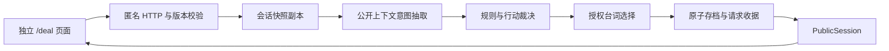

# DEAL V0.1 技术架构

依据：[PRD](deal-prd.md)。状态：已实现并完成本地验收；参见[审阅](deal-architecture-review.md)和[交付记录](deal-delivery.md)。

## 1. 工程边界

采用 `apps/deal` 独立 React/Vite Web 应用，唯一游戏路由 `/deal`。仓库已有 Vite 工具链，游戏不需要 SSR、Auro 的登录初始化、WebSocket 或工作区路由。静态资源可由独立 Go 服务同源托管，开发时 Vite 代理 `/api/deal`。不将 Auro 现有 Web/Desktop 改造成游戏壳；游戏 UI 是独立产品，不属于两端共享的 Auro 功能。

复用 `packages/ui` 的 Button、样式与 tokens，`packages/core/api/schema.ts` 的响应校验、TanStack Query、以及 `server/pkg/llm` 的模型调用边界。模型 SDK 不得在其他包直接引入。

`server/cmd/deal` 启动独立服务，不要求 PostgreSQL、Auro 账号或 agent CLI。`server/internal/deal` 包拥有游戏领域与 HTTP 接口。不创建 SQL 模型和迁移，不触碰现有任务数据。

物品与等待动作直接进入规则裁决和授权台词，跳过模型。存档提交是唯一世界状态写入点。

## 2. 数据模型

- Scenario：编译进服务器的版本化人物、事实、物品、对白和资源定义。
- Session：ID、所有权散列、版本、关卡/规则版本、创建时间、剧情时间、世界状态、心理状态、声明/信念、已处理语义输入、回合日志。
- Claim：命题 key、值、范围、原句、回合、冲突回合引用、澄清回合引用。只记录资金声明，不把声明当作客观真假。
- Belief：命题、可信度、来源事件引用；更新由规则执行。
- Receipt / Entry：实际输入、结构化提取、动作、发现、对白、姿态与实际耗时；同一快照保存世界与心理状态。
- PublicSession：仅公开时间、债务余额、已观察信息、可用物品动作、字幕记录和结局复盘。

首版文件存储：每局一个 JSON 快照包含完整已提交日志；临时文件写入、Sync、原子 rename 后返回成功。整个服务一次只允许一个进程使用数据目录，通过进程文件锁阻止双实例写入。服务内回合串行；网络模型调用不跨 DB 事务（本版本没有 DB）。该实现用于单实例 MVP，不宣称多实例共享存储。

## 3. 回合处理

1. HTTP 限制 JSON 大小，验证来源、匿名所有权、输入长度和请求结构。
2. 按会话串行加载快照，先检查请求 ID；相同 ID 不同 payload 拒绝，相同 payload 返回当前快照并不再执行。
3. 检查期望版本、未结束、物品所有权与动作条件。
4. 文字调用模型抽取结构化输入；物品动作直接形成确定事件。
5. 在快照副本上更新声明、信念、情绪、资金和行动；无效动作不提交。
6. 判定协议、红线、搜查机会和结局；生成允许对白集合。
7. AI 模式的文字回合调用模型选择允许的 `line_id`；物品与等待动作直接使用授权台词，避免多余模型调用。规则试玩选择确定台词。模型无法写自由事实。
8. 校验回合结果，持久化新快照，返回 PublicSession。模型/存储失败不提交，不扣剧情时间。

模型结构化返回执行本地严格校验；未知枚举、未知命题、无原文依据的声明、非法 line_id 拒绝。每个请求总预算 12 秒，禁止无限重新生成。模型的语法 JSON 模式不等于 Schema 校验。

## 4. 模型边界

默认 `llm` 模式，使用 `DEAL_LLM_API_KEY`、`DEAL_LLM_BASE_URL`、`DEAL_LLM_MODEL`（可复用 AURO_LLM 配置作为明确环境配置来源）。未配置返回可识别的服务状态，不能自动切换到规则引擎。`DEAL_MODEL_MODE=scripted` 是显式规则试玩和自动化测试模式。文字回合最多两次调用，共用 12 秒预算、传输重试为零；物品和等待回合不调用模型。

理解请求仅包含玩家原句、近期公开对话、玩家可观察物品及受限 Schema，不包含秘密和阈值。模型提取言语行为、目标、报价、声明（含原文片段与时间范围），不得给 effects/ending 字段。NPC 表演只收到引擎授权对白集合并选择 line_id，首版不开放自由改写。该约束主动交换部分语言变化，避免未经验证的语义校验器成为安全边界；以后扩展生成对白需要独立回归集。

服务器消费 `llm.Client` 要同步更新包消费者说明与契约测试。

## 5. HTTP 与身份

| 接口 | 作用 |
| --- | --- |
| GET /api/deal/status | 模式、可用性、关卡版本 |
| POST /api/deal/sessions | 创建新局，浏览器首次获得 HttpOnly 所有权 cookie |
| GET /api/deal/sessions/{id} | 获取玩家公开状态 |
| POST /api/deal/sessions/{id}/turns | 提交话语或物品动作 |

匿名所有权 token 使用加密随机数，cookie HttpOnly、SameSite=Strict、独立名称，HTTPS 时 Secure；服务保存 token 的 SHA-256。cookie 不属于 Auro auth。修改请求必须为 JSON，校验 Origin 同源，不提供跨域 CORS；未知会话与非本人统一 404。动态响应 no-store；禁止将完整 Session 作为响应序列化。请求 ID 仅做去重，不能代替身份。

输入最多 1,200 字符，每局最多 24 次推进动作；会话创建做 IP 限速、总局数上限限制磁盘资源。公网上线的分布式限速和账户预算另行设计。

## 6. 客户端状态与恢复

TanStack Query 保存 PublicSession 和服务状态。组件局部状态只保存输入草稿、选中物品、错误、待重试 payload 和 UI 视图。平台 StorageAdapter 仅保存当前 session ID，不保存服务器游戏状态或所有权 token。

请求失败保留 request_id 与 expected_version，重试不重新构造新请求。版本冲突重新读取状态并要求玩家重新提交，不自动重放旧意图。刷新读取存档；新局不会删除原局。响应使用 zod 和 parseWithFallback，坏响应保持可恢复界面且禁止继续提交。

## 7. 路线与反馈

规则按必要条件和目标决定行动，不用信任达到某数值直接获胜。恐惧对象独立、重复证据只贡献一次；相同言语行为、话题与提案的心理收益只贡献一次。查看本人物品无耗时；展示/交付/备份/谈判/搜查/等待返回推进 20 秒。临时离开只给一次搜查，搜查后自动返回，也可以直接等他回来。

满足必要条件后产生待确认提案；玩家下一步明确接受，才形成协议和结局。提出新条款会撤销旧提案，避免误接受已经失效的协议。未来资金声明保留在复盘中，不抵扣欠款。解释资金矛盾必须提供明确范围线索（现金与未来收入、账户或冻结），历史和澄清引用保留。

角色 SVG/CSS 姿态由确定 action/pose 映射，动作文字和台词构成可访问反馈。所有结局和复盘由事件生成，不能凭空生成玩家统计。复盘下载为本地文本文件，不自动公开分享。

## 8. 验证与运行

- Go 规则测试：四条结局、资金、重复策略、矛盾与澄清、信念来源、提示注入与知识隔离。
- HTTP/存储测试：所有权、来源、输入校验、幂等、版本冲突、模型失败不扣时、快照重启、并发请求。
- 模型模拟服务：用 fake HTTP endpoint 验证两阶段真实 SDK 请求与严格解析，不调用用户 agent CLI。
- 前端：响应畸形、未知枚举、错误重试、物品操作、完整路线与刷新恢复。
- 浏览器：桌面/窄屏、键盘、四条路线、重开和下载，保存截图与验收结果。
- 真人模型/陌生玩家/公开部署不由上述测试替代。

通过 `make up C=deal`、`make status C=deal`、`make down C=deal` 管理独立本地环境；数据在工作区 `.deal/`。规则试玩显式 `DEAL_MODEL_MODE=scripted make up C=deal`。生产先构建 apps/deal，Go 服务同源托管其 dist；不依赖 Vite 开发代理。完整命令与实际检查结果写入交付记录。
