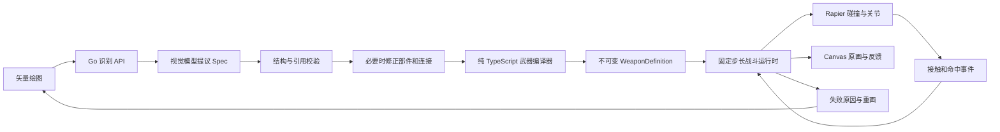

# Doodle Siege：画武器守城技术方案与项目复用

依据：[产品构想](画武器对战20261007.md)。日期：2026-10-07。状态：P0 已实现，实际范围与检查见[交付与验收](doodle-siege-delivery.md)。本文保留整体设计，P0+、P1、P2 的接口、容量与性能数字仍属于建议或验证目标，不能视为已交付能力。

## 1. 推荐方案

将 Doodle Siege 建成当前 monorepo 中的第二个独立游戏，入口暂定 `/siege/`。采用 **React/Vite + Canvas 2D + Rapier 2D + 独立 Go API**：React 管编辑器、确认界面和战斗外的操作；Canvas 展示玩家原画；Rapier 执行刚体、关节、碰撞；Go 管匿名身份、图像识别、蓝图存档和调用预算。

核心处理链是：

**矢量笔画 → AI 提议部件与连接 → 玩家确认歧义 → 确定性编译 → 测试场 → 守城 → 根据反馈重画。**

AI 不生成程序、不生成物理参数、不进入战斗循环。武器的原始笔画必须保留在战场上；改变长度、面积、连接点，应当改变范围、重量、转速或作用方向，而不只是改变贴图。

第一期验证“有限部件语法内的自由绘图”，而不是承诺“任何物体都能自动获得正确功能”。原文中的任意组合、马桶喷射、复杂剪刀、回旋镖、热力学和开放 PvP 是不同难度的后续能力，不能由八种部件识别自然推导出来。

### 1.1 首期范围

| 阶段 | 必须形成的闭环 | 范围约束 |
| --- | --- | --- |
| 技术原型 P0 | 画图、识别、修正、编译、攻击假人、重画 | 先实现 blade、hammer、wheel、shield；每件最多 4 个功能部件、1 个驱动轴 |
| 原型扩展 P0+ | 验证不同作用方式与组合 | 增加 spring、bow、fire、fan；只允许已定义的连接规则，不保证全部组合有效 |
| 可玩版本 P1 | 安装、3–5 波敌人、墨水预算、失败原因、再设计 | 3 个安装位、固定城堡、固定波次配置；单人本地战斗、匿名蓝图存档 |
| 后续 P2 | 每日挑战、作品分享、可信排名 | 先完成权威复算与版本治理，再开放排名；公开 UGC 单独设计 |

P0 是立项验证；P1 才是一个守城游戏。不能把测试场的演示效果作为完整游戏交付。

## 2. 项目复用基线与边界

下表记录方案制定时读取到的实现前基线，P0 已落地的模块见[交付文档](doodle-siege-delivery.md)。复用按模块职责判断，不给出缺乏依据的“复用百分比”。

| 现有能力与证据 | 新游戏如何使用 | 需要调整或新增的部分 |
| --- | --- | --- |
| [根 package.json](../package.json)、[pnpm-workspace.yaml](../pnpm-workspace.yaml)、[turbo.json](../turbo.json) | 沿用 pnpm 工作区、catalog、TypeScript、lint、Vitest、构建缓存 | 新应用声明直接依赖；新增 Rapier 依赖与锁文件，不升级整仓工具链 |
| [apps/deal](../apps/deal/package.json)、[Vite 配置](../apps/deal/vite.config.ts) | 参考独立 React/Vite 应用、路由 base、开发代理和正式构建方式 | 新建 apps/siege；不让 DEAL 页面承担绘图编辑器 |
| [packages/ui](../packages/ui/package.json)、[样式 tokens](../packages/ui/styles/tokens.css) | 直接复用按钮、弹窗、工具提示、基础布局、可访问交互和字体尺度 | 纸张、笔迹、战场、命中特效由游戏自己的渲染层实现 |
| [响应校验](../packages/core/api/schema.ts)、[DEAL 客户端](../packages/core/deal/index.ts) | 复用 zod + parseWithFallback；参考注入 transport、匿名 cookie、稳定错误码 | 新建 SiegeClient 和 siege Schema，不给 DealClient 增加游戏类型开关 |
| [StorageAdapter](../packages/core/types/storage.ts)、[DEAL 平台存储](../apps/deal/src/storage.ts) | 复用平台注入原则，持久化草图和偏好 | 大草图采用应用层 IndexedDB 适配器；不在 core 调用浏览器存储 |
| [server/pkg/llm](../server/pkg/llm/client.go) | 直接复用配置、SDK 单一入口、超时、重试控制、测试传输注入 | 当前 GenerateText/GenerateJSON 只收文本；新增小范围图像 + JSON Schema 接口 |
| [DEAL HTTP](../server/internal/deal/http.go)、[服务](../server/internal/deal/service.go) | 复用匿名所有权、同源写入、请求 ID、版本冲突和错误恢复的设计 | 实现 siege 自己的 HTTP/领域服务；绘图请求体和模型预算不能照搬文本回合限额 |
| [DEAL 文件存储](../server/internal/deal/store.go) | 参考进程锁、临时文件、sync、rename、提交收据模式 | 新蓝图快照和识别收据；不直接 import deal.Store，不把 Session 改成通用 map |
| [Go 启动入口](../server/cmd/deal/main.go)、[环境脚本](../scripts/deal-env.sh)、[Makefile](../Makefile) | 参考独立进程、同源静态托管、受管理的启停和进程身份检查 | 新增 cmd/siege、siege-env.sh、C=siege 分支；WASM 与 Worker 的资源策略单独验证 |
| [Playwright 配置](../apps/deal/playwright.config.ts)、[独立测试夹具](../e2e/deal/fixtures.ts) | 沿用独立游戏测试环境、失败 trace、场景化夹具模式 | 增加 e2e/siege，不依赖 Auro 账号或 PostgreSQL 初始化 |
| [CI 路径清单](../.github/ci-paths.json)、[CI 流程](../.github/workflows/ci.yml) | 使用现有流水线和质量检查 | frontend 清单目前未列 apps/deal；新增 apps/siege 必须显式加入，并配置游戏 E2E |

### 2.1 不直接复用的业务能力

- [Auro 主 API 客户端](../packages/core/api/client.ts) 会附加 Auro 身份、工作区 slug 和 CSRF 信息，并处理账号 401。匿名游戏应有自己的小客户端。
- Auro 的工作区、事项、聊天、智能体执行器、MCP、守护进程、WebSocket 和 PostgreSQL 都不是绘图守城的前置条件。
- DEAL 的人物心理、谈判规则、剧情时间和文本 Model 接口属于 DEAL 领域，不能扩展成新游戏的通用引擎。
- packages/views 适合两端共享的 Auro 业务页面；第一期独立游戏 UI 留在 apps/siege。新游戏不要求同时接入 Auro Web/Desktop 路由。

复用层次应是：**基础包直接复用；独立游戏工程模式参考复用；新玩法独立实现。** 目前只有两个玩法差异很大的游戏，不建立 GamePlatform、通用 ECS、插件系统或通用蓝图数据库。出现第三个具体消费者，且相同代码的职责稳定后，再考虑提取小模块。

### 2.2 建议目录与依赖方向

以下目录为拟新增：

```text
apps/siege/
  src/editor/                 绘图输入、撤销、部件高亮、连接点修正
  src/arena/                  Canvas 渲染、音效、命中反馈
  src/runtime/                Rapier 实现、固定步长循环、资源释放
  src/platform/               浏览器存储、图片导出、页面生命周期
  src/app.tsx                 编辑、测试、守城的业务入口
  playwright.config.ts
packages/core/siege/
  schema.ts                   API、Drawing、Spec 与版本契约
  client.ts                   匿名 API 客户端
  geometry.ts                 几何特征与碰撞近似描述
  compiler.ts                 Spec → WeaponDefinition，纯函数
  rules.ts                    部件、预算与平衡规则
  simulation.ts               波次、攻击、状态效果与事件逻辑
  physics-port.ts             很小的物理接口，无 DOM 或 React
server/internal/siege/
  http.go                     同源 API、所有权、请求限额
  recognition.go              调用 llm、验证部件引用与连接
  raster.go                   从矢量笔画生成模型输入 PNG
  service.go / store.go       蓝图版本、识别收据、文件提交
server/cmd/siege/main.go      独立服务与静态托管
scripts/siege-env.sh          独立环境生命周期
e2e/siege/                   游戏专用夹具与浏览器测试
```

依赖为 apps/siege → core/siege + ui，siege Go 服务 → pkg/llm + 小型基础工具。Rapier 适配器在应用层；core 只产生 Collider、Joint、Behavior 描述，通过 PhysicsPort 执行物理操作。不要让 core 为了方便导入 Canvas、react-dom、localStorage、process.env 或 WASM 初始化逻辑。

客户端模拟使用一套 TypeScript 规则。Go 不再写一份攻击和碰撞规则；将来需要排名时，使用相同 TypeScript 模拟代码做服务端复算，详见第 10 节。



## 3. 绘图表示：矢量是事实，PNG 是派生输入

### 3.1 最小契约

```ts
type Point = readonly [number, number]; // Integer grid coordinates.
type Primitive =
  | "blade" | "hammer" | "wheel" | "spring"
  | "bow" | "shield" | "fire" | "fan";

interface Drawing {
  schemaVersion: 1;
  revision: number;
  gridSize: 4096;
  strokes: Array<{
    id: string;
    points: Point[];
    width: number;
    color: "ink" | "accent";
  }>;
}

interface StrokeRef {
  strokeId: string;
  fromPoint: number;
  toPoint: number;
}

interface PartProposal {
  id: string;
  type: Primitive | "structure";
  strokeRefs: StrokeRef[];
  anchorHint: Point | null;
  directionHint: Point | null;
}

interface WeaponSpec {
  schemaVersion: 1;
  drawingHash: string;
  parts: PartProposal[];
  decorations: Array<{
    strokeRefs: StrokeRef[];
    attachedTo: string | null;
  }>;
  links: Array<{
    from: string;
    to: string;
    kind: "fixed" | "axle" | "elastic" | "effect";
    anchorHint: Point | null;
  }>;
  mountHint: Point | null;
  unresolved: string[];
}
```

这里只示意关键字段，正式契约需要范围、数组长度、互斥规则、引用完整性和错误码。structure 是连接杆或被动实体，不额外授予八种功能；decoration 不生成碰撞体。机械图可以引用 structure 的 ID。anchorHint 只是提议，最终锚点必须由几何约束或玩家修正确定。模型响应的 drawingHash 由服务器绑定，不信任模型自己填写的值。

编译结果 WeaponDefinition 包含：原画片段到刚体的映射、局部变换、碰撞近似、质量与惯量、关节、行为参数、墨水成本、warnings，以及 geometry/compiler/balance 版本。它是冻结的数据，不包含函数、脚本、URL 或模型生成代码。运行时的 body handle、冷却和 HP 不写回 Definition。

### 3.2 输入与坐标

1. Canvas 使用固定正方形设计坐标；Pointer Events 统一鼠标、触笔和触屏。pointerdown 捕获指针，pointerup/cancel 结束笔画；绘图区设置 touch-action: none，页面其他区域正常滚动。[MDN 绘图示例](https://developer.mozilla.org/en-US/docs/Web/API/Pointer_events/Using_Pointer_Events)、[指针捕获](https://developer.mozilla.org/en-US/docs/Web/API/Element/setPointerCapture)。
2. DOM 坐标通过完整逆变换映射至设计网格，处理布局缩放和设备像素比。禁止把 CSS 像素直接当物理单位。
3. 原始输入去重、限频后量化为整数点；保存笔画顺序和 ID。渲染路径与简化碰撞路径分开，不能为了碰撞优化破坏原画。
4. 首期只提供两种固定线宽，压力不改变属性；颜色只作装饰或高亮，不代表材质与元素。火焰能力必须来自明确 fire 部件，而不是涂红色。
5. 设计画布固定对应一块游戏空间，例如 8 m × 8 m，具体比例由试玩确定。只裁掉透明边缘，不把每件武器的包围盒都缩放成相同大小；否则长锤和短锤的长度差异会消失。
6. 安装只允许平移和旋转，不允许免费缩放。将来开放缩放必须重新编译质量、范围与成本。手机展示可以缩放视图，武器实际尺寸不变。

建议初始上限：64 笔、合计 4,096 个量化点、JSON 256 KiB；这是资源限制，不是性能实测结果。超限先提示玩家简化，不静默删掉关键笔画。

### 3.3 几何提取与识别输入

本地几何模块负责包围盒、路径长度、闭合情况、面积近似、质心、主轴、端点、稳定尖角和附近连接点。路径简化采用固定容差；自交或多重嵌套轮廓先标为复杂，不依赖一个 shoelace 面积值猜测所有情况。

模型读取的是服务器从相同 Drawing 重绘的整体 PNG、少量带编号的候选区域，以及允许的部件 Schema。服务器只需要受限的线段/圆端笔刷 PNG 栅格化，不执行 SVG、浏览器截图或外部渲染 CLI。避免上传一张图、编译另一套笔画造成语义错位。

第一期不引入 SAM、图像到 3D 或独立 CV 微服务。几何特征提供可验证的尺寸，视觉模型提供语义分组。P0 默认整笔引用，输入同时给模型有限的笔画 ID/点数元数据；不要求视觉模型准确猜中原始采样点序号。关键部件宜分笔绘制；一笔跨多个部件时让玩家圈选拆分，形成确定的非重叠 point range 后再编译。自动精细分割属于后续质量优化，不是首期隐含前提。

Drawing hash 来自服务器的规范序列化：固定字段顺序、整数坐标、稳定笔画序列，排除时间戳和 UI 选择。单纯 JSON.stringify 或 PNG 字节散列不能作为跨端几何身份的唯一依据。

## 4. AI 的职责与语义恢复

识别请求只允许提议八种功能部件、被动结构、装饰、笔画引用、连接类型、方向和待确认问题。不得返回 damage、mass、rpm、ink、胜率或“自动获胜”等字段。禁止输出代码并在客户端执行。

在 [pkg/llm](../server/pkg/llm/client.go) 内新增一个窄的视觉结构化请求方法，输入是已验证 PNG bytes、文本上下文和 Schema，返回结构化结果及拒绝/截断/用量信息。SDK 构造仍只存在于 pkg/llm，不在 siege 包直接导入 OpenAI SDK。当前文本 GenerateJSON 使用 JSON-object 模式，不能视为已有视觉识别接口。

选择一个明确支持图像和严格 JSON Schema 的部署模型，用冻结涂鸦集评估后决定型号；不借用文本助手的默认模型来推定视觉可用性。图像输入和 Structured Outputs 是两个需要一起验收的能力。严格结构化输出约束的是结构，语义仍可能错误；拒绝和截断也必须显式处理。[OpenAI 图像输入](https://developers.openai.com/api/docs/guides/images-vision)、[Structured Outputs](https://developers.openai.com/api/docs/guides/structured-outputs?api-mode=chat)。

每次识别通常一次模型调用，初始总 deadline 8 秒、传输重试 0；数字待真实服务测量。参数不支持就返回配置错误，不偷偷改模型、换协议或降为规则识别。更新 [消费者说明及契约测试](../server/pkg/llm/consumer_contract_test.go)，将新的方法名和 siege 调用点纳入检查，不能通过新增方法绕过既有扫描。

### 4.1 分层校验

- **传输层**：尺寸、PNG 格式、完整结束、非空输出、拒绝与超时。
- **结构层**：严格 Schema、未知字段、类型枚举、最大部件数、重复 ID。
- **引用层**：笔画与 point range 存在；范围没有越界；重复引用不产生重复质量和重复伤害。
- **几何层**：轴点落在允许区域，连接距离合理，方向非零；不信任模型精确坐标。
- **语法层**：必须能形成已支持的安装与运动结构；没有驱动路径的部件不能自行转动。

服务端负责结构、引用和资源限额；纯 TypeScript 编译器负责几何和运行语法。二者职责不同，不分别实现两份完整武器编译器。服务端保存的 Spec 表示“允许尝试编译”，不代表已证明可运行。

### 4.2 歧义由玩家快速修正

识别后高亮对应原画，展示“旋转锤”“弓”“盾”等简短标签。明确且通过编译的结果可直接进入测试场；歧义才展开“这部分是轮轴还是装饰？”“固定这里还是绕这里转？”一类局部修正。

不要使用模型自报 confidence 的某个阈值充当真实准确率。优先依据 unresolved、几何冲突和支持规则触发修正；置信度只能作诊断信号，经过标注集校准后再用于自动化。

同一 Drawing 与识别版本保存首次有效候选，反复点击不会随机抽到更强的武器。玩家修正 Spec 不必重新调用模型；改变 Drawing 后结果立即失效。异步返回同时核对 drawingHash 和 revision，旧结果可留在历史中，但不能覆盖正在编辑的新草图。

无法识别的线条可以保留为明确的装饰或被动结构，必须经玩家确认；不能暗中转成万能锤子，也不能把未知物体全部宣布为非法武器。比如马桶可以在首期作为被动结构测试，水箱喷射要等容器与喷射器语法实际实现后再开放。

## 5. 武器编译器与组合语法

### 5.1 编译步骤

`compileWeapon(Drawing, confirmedSpec, RulesConfig)` 是纯函数，返回 Definition 或具名错误；相同输入和版本产生相同描述。它不依赖 React、网络、系统时间或物理世界中的现有状态。

1. 校验 hash、版本与引用，形成部件的笔画集合；未分配笔画需明确标为装饰或结构。
2. 按原始大小计算特征；分离功能轮廓、结构线和装饰线，禁止同一实体面积被多次计重。
3. 建立机械连接图与效果附着图。`fixed/axle/elastic` 属于机械图，`effect` 表示火等能力附着，不自动制造关节。
4. 选择唯一安装根；不连通的功能部件提示连接。第一期机械图限制为树，拒绝闭环、多轴驱动和互相矛盾的连接。
5. 合并固定相连的部件为一个刚体组，再为组间关系生成转动或弹性约束。不是每个语义部件都生成一个刚体。
6. 生成有上限的碰撞近似、质量、质心和惯量，再生成行为与墨水成本。
7. 静态检查尺寸、重叠、碰撞数量、驱动预算、运动范围和安装位冲突。通过后冻结 Definition，测试场只实例化该定义。

连接点必须从原画的端点、圆心、接触区等候选中选择并吸附，容差随设计坐标固定。几何上的相交不意味着存在转轴：玩家画的轮子碰到锤子，只能形成候选连接，不能替玩家决定“焊接”还是“铰接”。

实体面积、重叠去重、质心与墨水计算应共用固定分辨率的设计网格覆盖估计，例如 128 × 128 的占用 mask；先拒绝无法稳定解释的自交轮廓。不能分别用 PNG 像素面积、包围盒面积与碰撞凸包面积计算三个互相矛盾的属性。网格分辨率属于 geometryVersion，碰撞近似误差必须能在预览中观察；尖角评价设最小边长与角度平滑，避免密集锯齿采样无限增加锋利度。

### 5.2 八种部件如何工作

| 部件 | 几何决定的部分 | 首期运行行为 | 连接与限制 |
| --- | --- | --- | --- |
| blade 刀刃 | 边缘位置、长度、稳定尖角 | 有效攻击期间，实际接触产生切割伤害 | 固定到摆臂或转子；不会在空中自动追踪 |
| hammer 锤头 | 有效面积、质心、力臂 | 摆动或旋转后的接触产生冲击与击退 | 必须有安装轴或驱动臂；更重会降低加速与攻击频率 |
| wheel 轮轴 | 圆心、半径、连接位置 | 转动关节加有限扭矩电机，带动刚体组 | 默认由城堡驱动；轮子本身不等于无限动力或车辆 |
| spring 弹簧 | 方向、长度、有效压缩行程 | 接近触发后压缩/释放，接触施加有限冲量 | P0+ 先做单轴伸缩结构，不模拟每圈弹簧线 |
| bow 弓 | 主轴、弧度、跨度 | 固定冷却发射有限速度箭矢 | 弓弦作为可视动作，不模拟软绳；发射方向可修正 |
| shield 盾 | 有效轮廓、覆盖面积 | 被动阻挡、耐久受损 | 静态安装；“盾 + 轮轴”可转动，但不免费获得攻击伤害 |
| fire 火源 | 部件位置与附着范围 | 有界烧灼/燃烧状态，效果区与原画部件绑定 | 固定到一个宿主；不是流体和温度场模拟 |
| fan 风扇 | 中心、有效扇叶面积、朝向 | 范围传感器对敌人施加有上限的力 | 重敌人加速度更小；不实现空气动力 CFD |

这些属于**几何驱动的游戏规则**。文档中弓的长短与伤害、弹簧形状与弹性、火焰大小与烧灼范围不能理解为材料力学或真实工程计算。没有材质选择时，弹性与密度由版本化部件规则确定，而不是从几根线准确推断。

### 5.3 组合例子与可预期结果

**轮轴 + 长杆 + 锤头**：轮轴中心吸附为城堡转动锚点；杆和锤头合并成同一转子；锤头原画移动到其真实局部坐标。固定扭矩下，杆更长扩大触及范围，锤头更重提高惯量并降低起转速度。实际打到敌人才产生伤害；不能识别出 hammer 就赋予整屏攻击。

**轮轴 + 刀片 + 火源**：刀片是同一转子上的刚体几何，火是附着效果；转子的位置驱动刀片原画和火效果的位置。切割与燃烧分别按规则结算，不能因为多画了三朵火把单体烧灼倍率无限叠加。

**弹簧 + 盾**：弹簧形成安装根到盾体的单轴弹性连接；敌人进入触发区时释放，盾体与敌人接触后击退。伸得太远、碰不到敌人或推力不足都应能从动画和反馈观察到。

**轮轴 + 弓**：首期不自动变成有寻敌能力的旋转炮塔。若规则只支持固定弓，提示固定安装或移除轮轴；后续定义炮塔行为后再开放。支持“有限组合”必须落实为明确行为，不能仅检查两个类型均在枚举中。

P0 安装骨架先支持“静态结构”和“单轴转子”；P0+ 增加“单轴弹簧”和“固定发射器”。骨架确定运动方式，玩家的部件、尺寸与连接决定运行差异。这样验证 Shape = Function，同时把首期约束在可调试范围内。

### 5.4 碰撞几何与渲染对应

- 原画按刚体组缓存到透明纹理，并随刚体局部坐标变换；安装、裁图时同时更新坐标变换，避免画与碰撞体偏移。
- 开放细线用少量 capsule 近似；闭合简单轮廓使用凸多边形或少量凸块。复杂凹形只有在明确分解并通过容量校验后才允许。
- 不把整个图做成一个 convex hull：U 形开口会被填死，长杆与轮子之间的空隙会变成可见之外的墙。轮轴可按部件语法解释为实体圆盘，但须预览确认；开放结构不能默认填充。
- 自交、过小片段、极细长轮廓、孔洞先提示简化或采用玩家确认的近似。不能用一个巨型包围盒静默代替。
- 每件初始限额 24 个 collider、4 个运动刚体、1 个动力轴。若局部近似做不到，拒绝该编译并保留画图。
- 提供“显示碰撞范围”的明确工具按钮，帮助调试命中差异，不把 collider、WASM 或编译版本放进默认玩家界面。

Rapier 官方建议移动物体使用简单或凸形碰撞体，复杂 polyline/trimesh 更适合固定环境；凸包也会改变凹轮廓。具体形状和稳定性必须结合本项目测试。[Rapier Colliders](https://rapier.rs/docs/user_guides/javascript/colliders/)。

## 6. 物理引擎选择与战斗循环

### 6.1 技术取舍

| 选项 | 与本项目的关系 | 决策 |
| --- | --- | --- |
| 原生 Canvas 2D | 足够表达纸张、玩家笔迹、有限敌人与特效；编辑器无需完整场景框架 | 首期采用；实际对象数量超出预算后，再测量是否需要 GPU 渲染 |
| Rapier 2D WASM | 提供刚体、转轴、关节电机、传感器和接触事件；适合验证旋转/弹性武器 | 首期采用官方 2D 包；异步初始化，锁定实际包与 WASM 版本 |
| Matter.js | JS-only、便于快速接入；任意凹轮廓同样需要额外分解 | 可用于已有 Matter 项目的原型，本项目不同时维护两套物理后端 |
| Phaser 或 PixiJS | 场景管理或 GPU 渲染可能有后续价值 | P0 不叠加，以免让渲染框架与 React、Rapier 各自管理生命周期 |
| Godot / Unity | 完整游戏发行、复杂关卡与编辑器支持有优势 | 当前优先复用 Web 工程；不能仅为“以后上 Steam”提前迁移 |

Rapier 支持转动/伸缩关节电机；Matter 的 fromVertices 若未接入凹多边形分解库，会使用凸包。选择 Rapier 的依据是本项目的可组合关节需求与后续复算路径，不是未经测量的性能排名。[Rapier Joints](https://rapier.rs/docs/user_guides/javascript/joints/)、[Matter Bodies](https://brm.io/matter-js/docs/classes/Bodies.html)。

使用官方 `@dimforge/rapier2d`，把 WASM 自带入构建产物并同源加载。先验证 Vite 资源加载；只有明确需要时才使用官方 compat 分发，不能从 CDN 加载漂移版本。[Rapier Getting started](https://rapier.rs/docs/user_guides/javascript/getting_started_js/)。

### 6.2 固定步长与状态归属

物理 tick 建议固定为 1/60 秒；渲染由 requestAnimationFrame 驱动，可插值。累计器每次最多执行 5 个 tick，后台或长期卡顿直接暂停，不追赶几十秒。波次和冷却按模拟 tick 计算，避免高刷新率浏览器攻速更快。

```text
Frame:
  read pending commands
  while accumulator >= fixedDt and steps < stepLimit:
    spawn scheduled enemies
    apply controllers and forces
    step physics
    collect contacts and trigger intersections
    settle bounded hits, effects, HP and deaths
    emit ordered domain events
  render interpolated scene
  publish low-frequency HUD snapshot
```

| 状态 | 归属 | 更新方式 |
| --- | --- | --- |
| 服务器蓝图、识别收据、服务状态 | TanStack Query | API 成功后更新/失效 |
| 草图、选中部件、编辑工具与偏好 | 局部 React 状态；必要时 core 中的小型 Zustand store | 用户操作，草图节流保存 |
| 刚体、敌人位置、HP、冷却、碰撞、当前波次 | 战斗运行时对象 | 每个 fixed tick 原地更新；不进 Query/Zustand |
| HUD、总结与失败原因 | 运行时输出的快照和事件投影 | 5–10 Hz 更新、重要事件即时更新 |

模拟核心无 DOM，通过 PhysicsPort 使用应用内 Rapier。PhysicsPort 只暴露当前实际需要的刚体、关节、碰撞和查询操作，不建立可插拔游戏引擎框架。React 重渲染不重建物理世界；StrictMode 下初始化与清理要能配对，卸载释放 RAF、事件、World、纹理和音频。

初期主线程运行，先把编译与渲染分开测量。只有物理工作持续占用帧预算才将模拟移入 Worker；采用命令与快照传输，不把整个 World 每帧序列化。生产 CSP 要测试 WASM 的编译策略与同源 Worker，不能原样复制 DEAL 的 script-src 策略。

### 6.3 碰撞、伤害和命中反馈

碰撞是伤害的证据，伤害规则由游戏定义。冲击伤害参考接触点相对速度、有效质量/惯量并限幅；切割参考接触边缘和有效攻速；风与火采用受限区域查询和状态效果。武器过重但电机转不起来时，不能仍然按质量直接发出最大伤害。

采用稳定的 `(attackCycle, weaponPart, enemy)` 命中键：一次摆击每个敌人结算一次；持续火焰按固定间隔结算；不能每帧接触都算一次暴击。接触事件按稳定实体 ID 排序后结算，不依赖物理库回调顺序。箭矢设置寿命、最大数量和高速检测策略，避免穿透；自体与相邻固定部件的碰撞按 collision groups 过滤。

效果传感器不应增加武器质量，应显式配置零密度；不能为多画火焰额外制造隐藏重物。击退、击杀、烧灼、格挡与耐久产生领域事件，用于反馈与总结；原画动画、命中特效和统计来自相同事件。

首期用三类敌人验证差异：轻型群怪、重甲慢怪、远距/飞行目标。飞行是游戏层的目标分类与高度，不声称 2D 模拟具有真实 3D 高度；近战碰撞/效果在目标规则中处理可达性。

复盘显示“锤子够不到”“起转太慢”“箭矢飞过目标”“风扇推不动重怪”等从事件统计得到的原因。AI 可以以后协助措辞，但不能凭空解释不存在的命中事件。

### 6.4 重放与确定性边界

保存 seed、初始蓝图和安装、版本配置、按 tick 记录的操作及事件摘要。相同 seed 只是必要条件；还需要固定实体创建/删除顺序、随机发生器、命中排序、浮点初始化和 timestep。

Rapier 官方描述了同版本 WASM 在相同初始条件下的跨平台确定性，并提醒 Math.sin/cos 等初始化运算可能破坏这一条件。因此本项目先验收固定版本和目标浏览器的重放，不直接把“用了 Rapier”写成“排行榜已经可信”。[Rapier Determinism](https://rapier.rs/docs/user_guides/javascript/determinism/)。

P1 刷新回到“本波开始”：保存本波初始配置和草图，重新运行波次，不要求持久化每帧位置。要实现中途恢复需增加明确的世界快照与规则状态快照，不能只恢复部分 HP 后继续。

## 7. 墨水、质量与驱动预算

原文先提出面积消耗墨水，后提出线长消耗墨水，两者不能不加定义地同时使用。首期采用一个明确的游戏预算：

```text
InkCost = roundUp(
  lineCost * unique structural path length * fixed brush factor
  + areaCost * effective solid area
  + partCost * powered/effect components
)
```

这是待调参的游戏规则，不是真实颜料消耗。轮轴、锤头、盾和刀身按确认的实体轮廓计面积；弹簧与弓等按对应部件的结构估计；开放细线按长度和固定宽度估计。装饰线也有绘图成本，但不额外赋予机械质量或攻击能力。重叠面积与近重叠结构不能重复贡献质量；刻意叠描不得增加能力。若完全相同的线条合并为 unique path，仍需保留原画来源与撤销关系。

图形面积用于部件规则下的实体近似，不能直接统计黑色像素作为质量：只描轮廓的大锤不应变成空心铁丝，涂满同一个轮廓也不应获得双倍重量。模型只能确定“这里是锤头”，尺寸和面积由几何规则得出；有歧义就由预览确认实体或开放结构。

规则配置须限制：总墨水、武器尺寸、驱动功率/最大扭矩、总烧灼速率、发射频率、同时存在的投射物和部件数。使用边际收益递减；多个动力部件共享每件武器的预算，而不是每个 wheel 都贡献无限马力。

首期资源规则建议：绘制、识别、测试、失败不扣游戏墨水；安装按冻结 Definition 占用预算；移除按相同成本释放占用；波次奖励与下一波预算由单一运行时规则更新。若增加消耗性弹药需单独说明，不能同时把同一笔画算制造成本和每发弹药成本。

撤销、擦除、修正后从当前 Drawing/Spec 重新计算。第一期橡皮按整笔移除，后续局部擦除要拆分引用、使旧 Spec 失效。编辑不能同时保留旧碰撞体与新低成本外观；正在战斗的 Definition 不可变，重画在波间替换并重新结算。

试玩至少检验四个不变量：长杆增加真实覆盖范围；同驱动下更大惯量减慢起转；同一区域反复涂画不无限增伤；缩放画布/手机视口不改变物理或墨水成本。

## 8. API、存档与调用预算

### 8.1 最小接口

| 拟新增接口 | 职责与返回 |
| --- | --- |
| GET /api/siege/status | 识别模式、可用性、支持的 Schema/部件/规则版本；不暴露密钥 |
| POST /api/siege/sessions | 建立匿名编辑会话和独立 HttpOnly 所有权 cookie |
| GET /api/siege/sessions/{id} | 当前蓝图清单、编辑版本、公开的识别状态 |
| POST /api/siege/sessions/{id}/recognitions | 提交不可变 Drawing；返回已校验的 Spec 候选和 receipt ID |
| GET /api/siege/sessions/{id}/recognitions/{requestId} | 响应丢失后恢复同一次识别的结果或未知状态，不再调用模型 |
| POST /api/siege/sessions/{id}/blueprints | 以 drawingHash、recognition receipt、确认后的 Spec 保存冻结蓝图，使用 request_id + expected_version |
| GET /api/siege/sessions/{id}/blueprints/{blueprintId} | 读取相同原画、Spec、规则版本，客户端重新编译 |

首期不设“上传客户端战斗结果即可排名”的接口。战斗运行、墨水结算和统计在客户端，服务器存档只是便利功能，不证明成绩真实性。编译不通过的蓝图可存为草稿，但不能标为已通过运行验收。

识别输入是不可变 Drawing，按 request_id + 规范 payload hash 去重，不借用蓝图的可变版本号来决定语义。蓝图写入才对会话 expected_version 执行比较。最终保存再次校验 Drawing 与 Spec 的 hash 和引用；服务端不能接受仅提交浏览器计算的 damage/ink 等数值。

UI 消费所有响应时使用 zod 与 parseWithFallback。展示状态的未知枚举可以显示为未知并保留操作恢复；执行契约里的未知部件、关节或不支持版本必须阻止运行并保留原画，不能 catch 成 blade 后继续编译。可选展示字段有默认值，关键 Drawing/Spec 失败返回可恢复的 invalid_response。

### 8.2 身份与请求恢复

使用独立 `siege_owner` cookie，限定 /api/siege、HttpOnly、SameSite=Strict，HTTPS 设置 Secure；服务端只存随机 token 的散列。未知资源和非本人资源统一 404。同源 JSON 写入、Origin 校验、请求体上限和速率限制沿用 DEAL 的设计；不复用 Auro auth cookie。

识别操作按以下流程处理：

1. 验证所有权和输入，再检查同 request_id 的收据；相同 ID 不同 payload 返回 409。
2. 检查同一匿名用户的调用额度、服务器总预算、并发数；通过后先持久化 processing 收据和本次预算预留。
3. 生成 PNG、调用模型、完成 Schema/引用校验，在同一收据中原子记录结果、模型部署版本和实际用量。
4. 只有结果写入成功才返回成功；游戏墨水与战斗状态不在此流程中修改。

网络丢失后客户端先读取收据；complete 返回原结果，processing 返回可恢复状态。进程在上游请求后崩溃、模型超时或完成结果无法落盘时，将该请求标为 outcome_unknown/failed，保守保留调用预算，禁止自动重发。用户明确重新识别才建立新 request_id；这次可能再次消耗服务预算，但不能重复扣游戏墨水。

P0 可用每会话串行锁和进程级有界并发，例如最多 2 个模型调用；deadline 包含等待，不创建无限后台队列。长任务、队列服务和分布式调度没有首期必要性。多标签蓝图版本冲突重新读取并提示选择，不自动覆盖新画图。

### 8.3 单实例存储与缓存

P0/P1 用 `.siege/` 下的识别收据与蓝图 JSON 快照，文件目录进程锁保证单实例。写入通过临时文件、文件 sync、rename、目录 sync 完成；明确文件权限、容量上限和损坏错误。参考 DEAL 的实现方式，但新增存储需自己的故障测试，不能把 DEAL 的重启测试结果直接算作 siege 验收。

蓝图保存 Drawing、confirmed Spec、原画到部件引用、识别来源、geometry/compiler/balance/schema 版本；旧蓝图版本不静默重新识别或重算成新规则。unsupported_version 展示原画并允许复制为新草稿。也保留模型提议与玩家修正的区别，便于分析识别失败。

初始可设全局 1,000 份蓝图、每所有者 50 份，并为识别收据配置总字节上限与 7 天保留期；这些是待确认的内部原型限额。满额返回明确错误，不随机删档。清理只处理过期收据与未引用派生 PNG，不删除仍引用它们的蓝图；需要更长恢复窗口时显式扩容。不能仅限制单次 JSON 大小而让长期磁盘、索引和锁表无限增长。

缓存先限于同一所有者，key 由服务器构造：

```text
ownerScope + canonicalDrawingHash
  + recognizerDeploymentVersion + promptVersion + recognitionSchemaVersion
```

编译缓存单独加入 confirmedSpecHash、geometry/compiler/balance 版本。解析结果不能只按 PNG 缓存，运行结果也不能只按模型名称缓存。将来公开作品去重再考虑跨用户缓存和共享权限。

匿名调用限速包含 owner 与可信来源 IP，IP 需按部署代理边界解析。全局成本预算和熔断是必须项，cookie 可以被重新创建，不能视为防滥用账号。默认日志只记请求、版本、耗时、大小和错误码，原画/PNG/原始模型输出不直接写入通用日志。

成本测量记录每次实际图像/文本输入、输出用量和供应商计费项：

```text
每个有效设计的成本 = 完整识别尝试总成本 / 可进入测试场的设计数
```

不能仅按“每张图一次调用”断言成本低；误识别、超时与重画会影响每个有效设计的成本。原型完成后再用实际模型报价与用量计算预算，本方案不虚构单次价格。

## 9. 跨端复用与产品入口

**第一阶段 Web**：移动浏览器与桌面浏览器共用 apps/siege，采用宽屏“绘图/测试场并排”、窄屏“画图/测试切换”。工具按钮、确认问题、开始/暂停、重画与下载使用可访问 DOM；Canvas 有文本战斗摘要。减少动态效果设置只影响装饰动画，不改变模拟速度。声音由用户手势启用，所有关键反馈也有视觉形式。

**桌面发行阶段**：先把同一 Web 产物用于独立的游戏 Electron 壳，复用仓库的构建与签名经验；不把游戏强制加入 Auro 工作区标签页。若产品明确要求在 Auro 桌面内打开，再按其 NavigationAdapter 与 DragStrip 边界接入。现有 Auro Electron 壳能跑 Web 不代表已有 Steam、手柄、游戏窗口或离线模型验收。

**移动原生阶段**：apps/mobile 是独立 Expo Auro 客户端，不能直接塞入 React DOM、Canvas 或 Rapier 浏览器实现。首期移动浏览器验收后，再根据分发需要选择独立游戏壳承载同一 Web 产物，或实现原生绘图/渲染适配器。原生路线复用 Drawing/Spec/几何与规则类型，需要重新验证 WASM、物理后端和触控性能；不承诺 Web 与原生代码完全共用。

**静态发布**：独立 Go 服务同源托管 /siege 与 /api/siege，暂不依赖 Auro 服务。如果后续统一游戏门户，只让反向代理或轻量页面链接到各独立游戏；不合并会话数据、账号边界和游戏引擎。

新增入口时遵循仓库单词路由约定，更新 [reserved_slugs.json](../server/internal/handler/reserved_slugs.json)，执行 pnpm generate:reserved-slugs，保留生成的 [reserved-slugs.ts](../packages/core/paths/reserved-slugs.ts)。本次是文档方案，尚未注册 /siege 路由。

## 10. 每日挑战与排名的后续边界

每日挑战可以先发布固定种子与波次，在本地展示个人结果。公开可信排名必须新增服务端复算：

1. Go 下发 challenge ID、种子、完整规则与时效；识别并保存其版本绑定的 Drawing/Spec。
2. 玩家提交已保存蓝图 ID、合法安装配置、按 tick 的受限操作日志，不能提交自定义伤害或直接提供总分。
3. 有界的 Node 复算进程使用同一 core/siege 模拟核心、同版本 Rapier/WASM 与相同规则，从初始状态运行；Go 管作业和验收结果。
4. 比较检查点与复算结局，成绩由服务器计算。客户端渲染、截图和视频只是展示，不是信任证据。

这是明确的扩展条件，P0 不提前部署 Node 服务。当前规则用纯 TypeScript 和小型 PhysicsPort 保留复算可能性即可。真正进入 P2 时再提取稳定的游戏运行包；不能因“以后排名”今天就实现通用多语言引擎。

公开作品分享另需发布授权、作品可见性、举报和删除、资源存储生命周期。P1 先做本地 PNG 下载与蓝图 JSON 导出，不自动上传或发布玩家绘图；排行榜和异步 PvP 不能由导出按钮替代。

## 11. 验证计划与性能预算

### 11.1 四层验证

| 层次 | 重点 | 不能替代的验证 |
| --- | --- | --- |
| core 纯逻辑测试 | 笔画引用、几何边界、碰撞近似、成本、连接语法、命中去重与版本绑定 | 真实物理稳定性、模型语义 |
| Rapier 集成 + Go/API 契约 | 长杆/惯量对比、关节约束、事件顺序；图像请求、匿名所有权、收据、超时、存档恢复 | 真实网关能力与陌生涂鸦 |
| 浏览器验收 | 真正用 pointer 画图、部件修正、原画移动与碰撞对齐、窄屏、重画、刷新、下载、错误恢复 | 真实设备性能与玩家留存 |
| 真实模型与陌生玩家 | 冻结数据集、准确性、修正次数、延迟、每有效设计成本、主动重画行为 | 不可用 scripted/fixture 模式的成功代替 |

默认测试使用假 HTTP 模型，覆盖图片消息、严格 Schema、拒绝、截断、乱码、未知部件、伪造 strokeRef、越界锚点和上游失败。无 DOM 的 core 测试使用仓库规定的 node Vitest 环境；组件只测试输入与模拟的连接，不复制完整几何矩阵。

E2E 用 Siege 专用 TestApiClient 夹具模式管理自己建立的资源，参考 DEAL 的独立 fixtures；不得拿 Auro 工作区 TestApiClient 强行创建匿名游戏。fixture 识别模式只匹配已知 Drawing hash，不作为任意涂鸦自动识别器。

必须有行为回归：旋转锤不变成车辆；轮轴与刀片原画仍保留；细线/空白/自交不会崩溃；旧模型响应不覆盖新草图；同 request_id 丢失响应不重复调用；拖动离开画布不会卡住绘图；超时不删草图、不扣墨水；重复接触不重复爆伤；缩放视口不改变范围；刷新恢复到完整波次起点。

### 11.2 真实语义与玩法验证

准备 60 个标注设计：24 个单部件变体、16 个组合、10 个歧义/一笔跨部件、10 个无效/装饰/提示注入样例。区分调参与保留集，标注玩家预期的部件、安装点、运动方式和可接受修正；不能只评“武器名称猜对了”。

建议立项门槛：受支持设计中，至少 80% 能在零或一次局部修正后运行预期行为；单部件和组合分别报结果；所有输入都不执行模型代码、不产生非有限参数或无界资源。80% 是待确认的目标，不是准确率事实。小数据集只能指导方向，不能外推开放涂鸦的总体正确率。

邀请 5–8 位陌生试玩者，观察首个能运行的设计是否能在约 2 分钟内完成，以及 20 分钟内是否主动经历至少 5 次“测试 → 修改”的循环。记录退出时机、修正负担、重画动机和首次意外效果；不以展示视频或口头“很酷”作为通过。

若标注集识别达标但玩家不愿重画，优先改敌人挑战和反馈；若语义不达标，优先缩小支持语法、改善部件修正，不先增加关卡或训练大模型。是否需要 AI 也要用“无 AI 的手动部件标注”对照来验证；AI 不可替代目前只是产品假设。

### 11.3 性能与容量目标

以下是首轮测试预算，需记录具体电脑/手机、浏览器、版本和场景后才能报告实测：

| 项目 | 初始目标或上限 |
| --- | --- |
| 绘图反馈 | p95 输入到可见笔迹 < 33 ms |
| 几何提取 + 编译 | 上限草图 p95 < 100 ms；超过时有处理状态，不阻塞输入 |
| 模拟 | 桌面参考设备 fixed tick p95 < 8 ms；目标 60 FPS |
| 移动浏览器 | 明确一台中档真实设备，目标持续 30 FPS；触屏模拟不能代替 |
| 战斗规模 | 初始 3 武器、100 敌人、40 投射物，动态刚体 ≤ 160、总 collider ≤ 256 |
| 模型识别 | 总 deadline 初始 8 秒；分别记录 p50/p95 与超时率 |
| 生命周期 | 连续重画/重开 30 次，World/RAF/监听器数量不增长；检查内存趋势 |

容量在编译、生成敌人和发射投射物三个入口统一校验；达到投射物上限按既定规则延迟发射，不让无限生成拖垮浏览器。视觉质量可降级，伤害与波次不能为了低性能机器偷偷改变。

## 12. 实施顺序与交付标准

### 12.1 七天验证原型

原文的“7 天”适合作为技术验证期限，不适合作为八种任意组合、完整守城、跨端发行的交付承诺。下表假设一名熟悉 Web/Go 的开发者与一名熟悉物理玩法的开发者并行投入；单人开发应先保证四部件的 P0，再按实测调整工期。

| 日程 | 工作与可审查产物 | 阶段判定 |
| --- | --- | --- |
| 第 1 天 | apps/siege 工程、Drawing Schema、指针输入、撤销；准备首批手绘样本 | 原画可以保存、重开、正确映射到设计坐标 |
| 第 2 天 | 不接 AI，手工 Spec 编译 blade/hammer/wheel/shield，搭假人测试场 | 长度、质量与转轴差异在运行中可观察 |
| 第 3 天 | 固定步长、有限驱动、命中去重、墨水计算、碰撞预览 | 高质量原画不掩盖碰撞错位，空白/复杂输入可恢复 |
| 第 4 天 | pkg/llm 图像 Schema 方法、Go PNG、匿名 API、模型假服务 | 图像请求与错误处理有契约；真实服务单独验证 |
| 第 5 天 | 模型候选、局部修正、连接高亮、版本与收据恢复 | 玩家能修正旋转锤误判，不靠重抽模型 |
| 第 6 天 | 跑保留集、陌生试玩、性能记录；决定是否加 spring/bow/fire/fan | 先看关键风险，未达标就缩范围 |
| 第 7 天 | 修复阻塞项、整理评估报告、浏览器演示与可运行环境 | 交付 P0 Go/No-go 结论；有余力才加单波守城切片 |

第二阶段在 P0 通过后补八部件的已支持组合、3–5 波、波间重画、完整总结与本地导出。工期应基于原型中语义修正率与物理稳定性估算，不能直接沿用“七天”。

### 12.2 工程接入清单

- 新建上述最小目录，给 core 增加 @auro/core/siege 子路径导出；按消费方声明直接依赖，用现有 catalog。
- 新增独立 /siege 入口和 API，同步 reserved slugs；不修改 DEAL 谈判玩法。
- 新增 SIEGE_RECOGNITION_MODE=llm/fixture 显式模式和独立模型配置；fixture 只用于样本演示与自动化测试，不在模型不可用时自动启用。
- 接入 make up/status/down C=siege；独立端口、.siege 数据、日志与进程身份，down 保留数据。首次启动验证端口冲突与正式静态托管。
- 更新 AGENTS.md 中独立游戏命令边界；CI frontend 增加 apps/siege，检查 scripts 和专用 E2E 的触发范围。
- 配置模型调用总预算、同源 PNG/WASM 资源、状态接口与生产 CSP；默认运行不调用用户 agent CLI。
- 更新模型消费者列表及扫描测试，给新接口加 malformed-response 与请求收据回归；不只修改提示词。

实现后的建议验收命令如下，当前尚不存在 @auro/siege 与 cmd/siege，**本次未执行**：

```sh
pnpm --filter @auro/core typecheck
pnpm --filter @auro/core test -- siege
pnpm --filter @auro/siege typecheck
pnpm --filter @auro/siege lint
pnpm --filter @auro/siege test
pnpm --filter @auro/siege build
(cd server && go test ./internal/siege ./cmd/siege ./pkg/llm)
SIEGE_RECOGNITION_MODE=fixture make up C=siege
pnpm exec playwright test --config apps/siege/playwright.config.ts
make status C=siege
make down C=siege
```

修改公共包后，再跑受影响的 DEAL 回归与相关公共包检查。真实模型评估、正式同源部署、Safari/Chrome、移动设备和发行包分别留下结果，不把一个构建成功当成全部验收。

## 13. 设计审阅结论与剩余问题

本方案的可行性建立在受限的组合语法、原画与碰撞对应、局部修正、有限驱动和成熟物理库上。复用 monorepo 的基础工具与独立服务模式，新增一个边界清楚的绘图守城领域；当前不需要换整个项目架构或先搭游戏平台。

立项前最需要实验回答的是：陌生涂鸦的部件/连接识别能否达到目标；有限语法能否产生玩家期待的奇怪武器；尺寸与惯量差异是否有趣；重画反馈是否明确；移动浏览器能否承受目标场景。这五项不能靠官方库能力或现有 DEAL 测试推断。

本次已读取需求、DEAL 客户端/服务/存储、pkg/llm、共享包边界、工具链、环境脚本和 CI 配置，并核对所引用的官方文档。尚未安装新依赖、调用真实模型、修改游戏源码、注册路由、运行游戏测试或公开部署。

当前目录没有 Git 元数据，不能执行工作树 diff 检查或提交；仓库规则引用的 apps/docs/conventions 文档及 CONTRIBUTING.md 在本 checkout 中未找到。本文按已提供的 AGENTS.md 的领域、命名和简洁文案规则撰写；这些缺失文件不应被当成已读取的规范。
