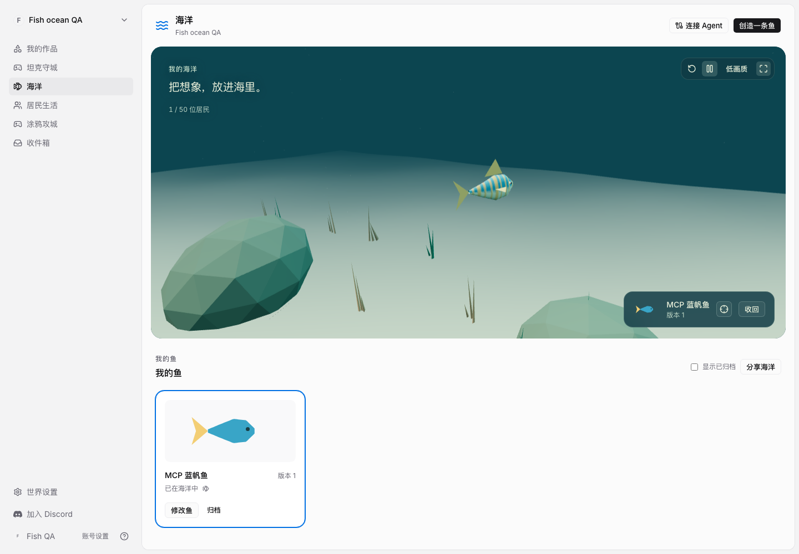
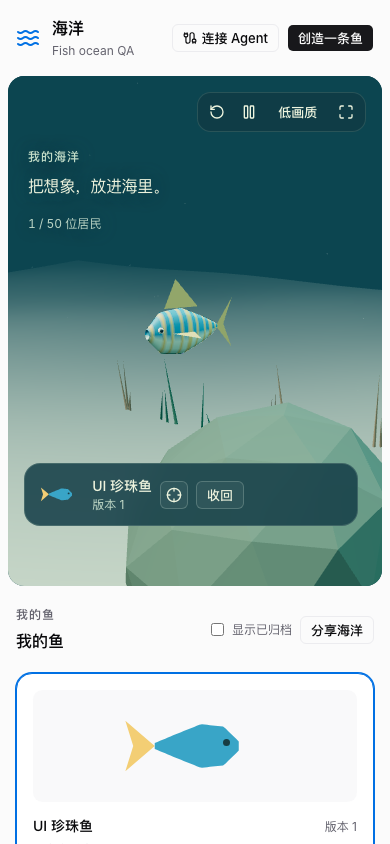
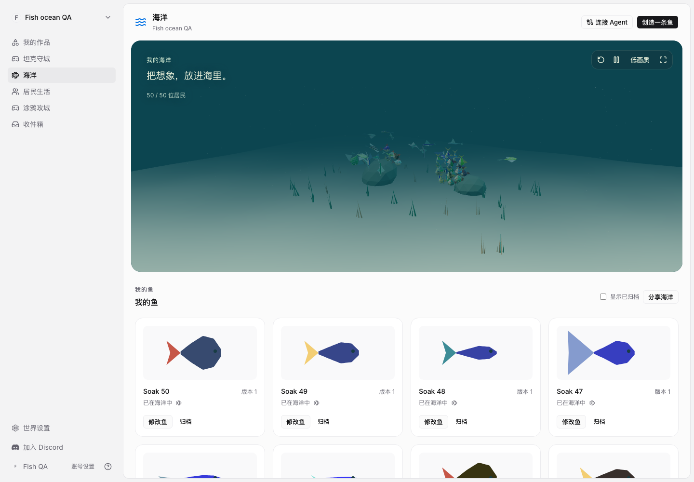

# Fish 首版验收：2026-11-03

## 交付范围

Fish 已作为现有主应用的世界功能实现，Web 与 Desktop 共享 `/{slug}/fish`，没有独立 app、身份或部署单元。每个世界成员拥有私有海洋，可以向当前世界成员开放参观。外部 Agent 通过 `fish@1` 的外形/行为数据校验、保存、投放鱼；作品版本与海洋居民分开保存。

已验证的产品闭环包括 MCP 读取规范、非法描述提示、幂等保存/投放、准确居民定位、刷新恢复、显式应用改版、收回保留作品、界面创作、我的创作入口、私有海洋访问限制、窄屏和全屏退出保持场景挂载。

## 检查结果

| 检查 | 结果 |
| --- | --- |
| Core 全量 | 143 个文件、1561 项测试通过 |
| Views 全量 | 323 个文件通过；4098 项通过，1 项 Siege 第八关战役平衡测试在并行负载中超过 5 秒 |
| 上述战役用例单独重跑 | 通过，运行约 0.8 秒，未修改战役实现或放宽测试超时 |
| 相关导航/我的创作/搜索/管理组件 | 34 项通过 |
| Fish PostgreSQL | 一次性 schema；版本冻结、重试幂等、并发容量、隐私、成员退出、归档、回滚及不支持的编译器版本通过 |
| 游戏管理 PostgreSQL | 一次性 schema 的完整策略测试通过 |
| Go | Fish、CLI、`cmd/auro`、`cmd/server`、gameadmin 包测试通过 |
| Node MCP 连接器 | 在原生 Node 中针对临时 HTTP 服务和浏览器回调 fixture 验证通过；没有调用真实 Agent CLI |
| 类型检查 | Core、Views、Web、Desktop 通过 |
| Lint | 变更的 Core/Views 文件以及 Web/Desktop 通过；Desktop 保留一项已有 tab-content hook 依赖警告 |
| 构建 | Web 生产构建及 Desktop 构建通过，Fish 场景独立懒加载 |
| 契约与文档 | 生成目录一致、五语键一致、文档链接与 diff 空白检查通过 |

生产构建运行三项浏览器场景通过，包括 50 条鱼的十分钟连续运行：场景持续存在，无 `pageerror`，Three.js 几何资源计数前后相同。此后对渲染细节、全屏和绘制开销的调整另做短时完整闭环复核。

开发模式的一次长测受到源码 Fast Refresh 干扰，回到世界加载状态；它没有作为稳定性通过记录。正式长测使用固定的生产构建。

## 画面与性能

- 50 条鱼从六种基础轮廓派生，分别编译独立的几何、尺寸和配色，不靠一份相同鱼网格的实例化证明容量。
- 海草使用共享几何与材质进行实例化，鱼的自定义形状仍分别编译。鱼体、鳍尾和眼睛合并为同一个鱼网格。
- 浏览器视窗 1440×1000，Headless Chromium 145，允许 SwiftShader。当前环境没有被认定为方案中的固定硬件基准，不据此承诺所有设备的帧率。
- 最终 60 秒短测：2046 个采样帧，p50 33.3ms、p95 34.7ms，55 次绘制、55 份几何资源。空白页参考 p50 16.7ms；当前 50 鱼场景未达到讨论稿中 p95 ≤20ms 的目标，仍需性能优化与真实设备基准，不能宣称 60fps。
- [最终短测原始数据](fish-2026-11-03/fifty-fish.json)。此文件记录最终短测的实际时长，不能把它当成十分钟原始帧率数据。

## 实际边界

- 仅在本地托管环境启动并验收，未部署到生产服务器。
- HTTP/MCP、Node 连接器和浏览器闭环已验收；未调用真实 Codex 等 Agent CLI 或模型进行烟测。
- 原生 Mobile 不在本次实现范围，浏览器完成窄屏适配。
- 居民与作品永久保存，位置与游动在客户端计算；没有离线繁殖、捕食、喂养与权威生态。
- 公开海洋的访客通过五秒轮询读取变更；作者另有现有 WebSocket 缓存失效事件。当前不投递世界摘要或 OS 通知。
- 十分钟测试检查几何资源数量和页面异常，不等同于完整 GPU 内存泄漏证明；跨设备、跨浏览器和更长时间运行仍需要补充验收。
