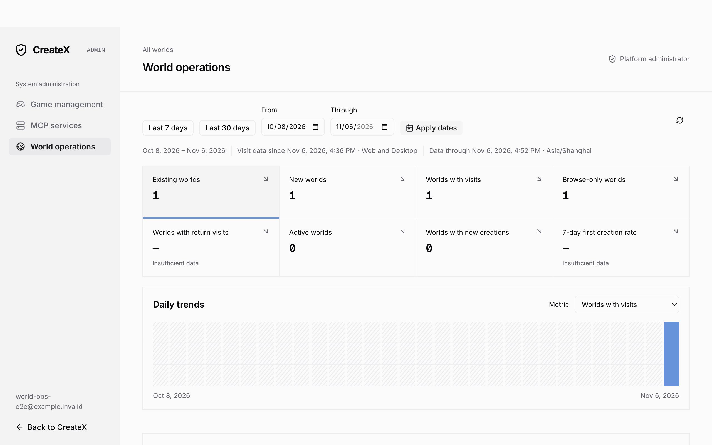

# World operations native verification

2026-11-06

The isolated macOS Electron scenario passed against a real managed Go API and
PostgreSQL database. It used the built Desktop renderer at a file URL and a
test-created fake CLI in an isolated application home.

Verified foreground visits carried the selected world ID and Desktop platform
metadata. Verified Admin overlay module switching, overview filters, world
detail navigation, persisted follow-ups, restored search and group filters,
and return to the active world after closing the overlay.

The first native launch exposed an ESM default-import failure for fix-path.
Enabling automatic interop in the main-process Rollup output fixed startup.
The final native Playwright scenario passed in 4.1 seconds. Desktop build,
typecheck, navigation/path unit tests (25 tests), and the world operations
PostgreSQL regression passed.

The changes are preserved in world-operations-native.patch in this isolated
checkout for the deployment task to review and integrate.

