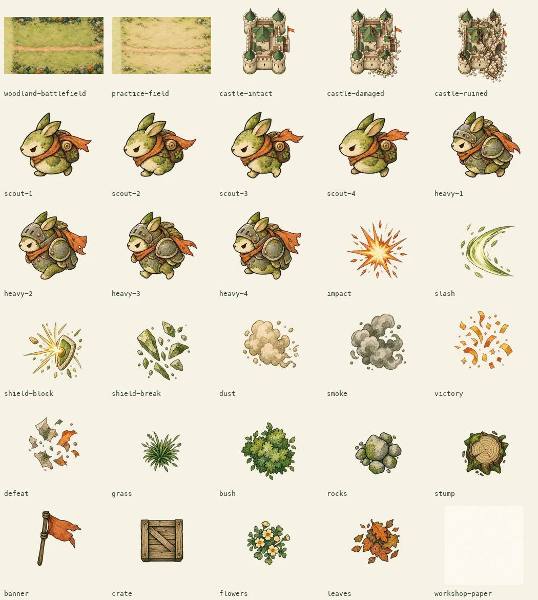

# Doodle Siege P0 素材包

生成入口：用户指定的内置浏览器 ChatGPT 网页。规格与逐张提示词见 [prompts.json](prompts.json)。提示词使用统一 `style` 加每张 `prompt`，同一生成对话保持风格一致。

已完成七组图片生成、文件导出、透明检查、裁切和游戏接入，共三十张运行素材。生成对话保留在 [ChatGPT 网页](https://chatgpt.com/c/6ac63ec9-bbb8-83ea-a3a6-391fc427147d)。

| 类别 | 素材 | 数量 |
| --- | --- | ---: |
| 地图 | 林地守城、浅色测试场 | 2 |
| 城堡 | 完整、受损、坍塌 | 3 |
| 敌人 | 普通与重甲，各四帧行走 | 8 |
| 特效 | 命中、切击、格挡、盾碎、尘土、烟、胜利、失败 | 8 |
| 装饰 | 草、灌木、石堆、树桩、旗、木箱、花、落叶 | 8 |
| 纸纹 | 工坊浅奶油纸 | 1 |

范围对应当前 P0，不新增武器类型或关卡机制。玩家画的武器继续由原始笔画渲染。



## 文件与复用

| 位置 | 用途 |
| --- | --- |
| [source/](source/) | 七组实际生成图片的优化 WebP 来源，可重新裁切与导出 |
| [source/receipts.json](source/receipts.json) | 网页导出字节数、SHA-256、尺寸，以及原 PNG 的尺寸与 SHA-256 |
| [prompts.json](prompts.json) | 统一风格、各组提示词、精灵排列与交付预算 |
| [apps/siege/public/art/](../../apps/siege/public/art/) | 三十张游戏运行 WebP |
| [manifest.json](../../apps/siege/public/art/manifest.json) | 运行文件校验值、尺寸、质量、实际裁切与对齐坐标 |
| [scripts/siege-art-assets.py](../../scripts/siege-art-assets.py) | 校验来源、寻找透明间隔、保持帧锚点并按预算导出 |

原 PNG 的生成文件与下载入口见生成对话，网页工作目录为 `/mnt/data/siege-preserved/`；本地来源为完整导出的优化 WebP，不将本地文件标为原始 PNG。七组 WebP 均已与网页 Python 输出的字节数和 SHA-256 对照一致。工作截图与传输临时文件放在被忽略的 `.siege/art-work/`，不随游戏发布。

需要重新导出时，使用 Python 3 与 Pillow，从仓库根目录执行：

```sh
python3 scripts/siege-art-assets.py \
  --source-metadata docs/siege-art/source/receipts.json \
  --conversation https://chatgpt.com/c/6ac63ec9-bbb8-83ea-a3a6-391fc427147d
```

脚本先检查全部来源和编码结果，再写运行素材。格子边界移到实际透明间隔，恢复名义格子的坐标原点，并为同一角色的四帧使用共同裁切范围；城堡旗帜不会被机械等分截断，行走帧不会因逐帧紧裁切而跳位。清单保留 `cell`、`crop`、`alignmentOffset`，方便检查与调整。

图片加载、场景、动画和特效留在 `apps/siege/src/arena/`。地图按相机尺寸覆盖画面；城堡读取 `castleHP`；普通与重甲敌人读取类型、位置和战斗 tick；命中、格挡、碎盾、烟尘与结束效果读取已有战斗事实。特效数量最多二十四个，生命周期按模拟 tick 计算，暂停时一起冻结；减少动态效果偏好会固定行走帧并关闭特效缩放。core 的几何、编译、伤害和 Rapier 碰撞没有依赖这些图片。

## 验收

- 三十张文件均可解码，尺寸与清单一致，校验值一致；四组精灵来源具有真实 RGBA 透明通道，透明角点与可见主体均已检查。
- 素材总览逐张视觉检查通过：无棋盘假透明、混入相邻精灵或裁断旗帜；两组行走帧采用一致锚点。所有图片继续保留奶油纸、绿墨、水彩和锈橙风格。
- 运行素材总计 **978,354 字节（约 955 KiB）**，最大单张 **195,914 字节（约 191 KiB）**，全部低于每张 300 KiB 预算。
- `pnpm --filter @auro/siege typecheck`、`lint`、`test`、`build` 均通过；真实 Rapier 测试两项通过。
- 内置浏览器验证 1280px 桌面与 390px 窄屏；窄屏内容宽度为 390px，无横向溢出。测试场、三波守城、原画旋转、敌人和血量、城堡坍塌、碰撞调试叠加均正常。暂停前后截图字节一致，继续后计时恢复。
- 最新构建通过 `http://127.0.0.1:18107/siege/` 的 Go 静态服务加载并完成守城试玩，浏览器没有错误日志；三十张构建目录素材均与清单校验值一致。
- 未运行全仓 Auro 或 Go 后端测试，也未做真实触控设备验收；本次改动为素材、文档和游戏展示层。构建仍提示既有 Rapier WASM 大 chunk，未因素材接入扩展物理包。
