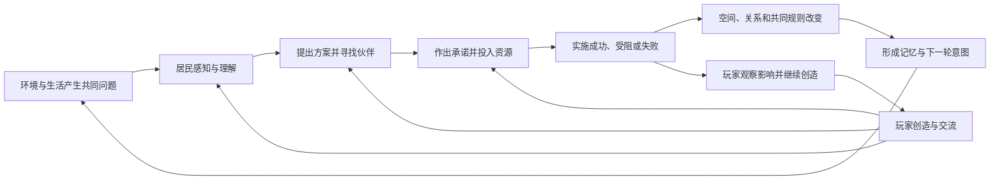

# Weavea 自主文明世界 · 产品与游戏设计讨论稿

版本 v0.4 · 2026-11-06 · 产品方向、小镇开局与写实 3D 表现已确认，具体机制待讨论

本稿用于确定 Life 的游戏方向和下一阶段范围。用户已确认以下五项方向。公共粮仓场景、具体规则、参数和交付顺序仍为设计提议。

| 已确认的决定 | 对游戏设计的约束 |
| --- | --- |
| 造物者，创造生命与事物，轻度影响世界 | 玩家提供可能性与建议，居民决定采用方式与合作关系 |
| 优先聚落建设、群体组织与文化规则 | 首个完整版本必须出现实际建设、共同约定和持续的社会后果 |
| 可缩放的俯视世界，点进人物与故事 | 世界地图承载主要体验，人物、工程与历史随选择展开 |
| 从已经有人生活的小镇开始 | 开局即有日常生活与功能地点，文明变化来自合作、公共改造、组织与文化的逐步发展 |
| 写实比例的 3D 小镇，自然材质、光照与人物动作 | 以真实空间尺度、立体场景和角色骨骼动作承载可缩放的俯视观察 |

本稿沿用现有小镇任务书的基础能力，文明层属于本轮提出的新设计。

## 1. 产品主张

**创造生命，编织世界。你的创造，会被居民使用、理解、争论，并逐渐成为文明的一部分。**

玩家进入一个持续生活的聚落，认识其中的居民，看见他们如何应对共同问题。一次约定可能变成公共工程，一次失败可能改变分工，一件作品可能带来新的习惯。玩家通过创造与有限的交流参与其中，再回来观察那些影响如何扩散。

核心吸引力是三个可以反复追问的问题。

1. 我离开以后，这里发生了什么？
2. 他们为什么作出这个选择，接下来可能怎么办？
3. 我创造的生命或事物，最后怎样改变了世界？

「文明」在近期版本中的具体含义，是一群居民形成了能够持续运行、被共同使用和修改的组织方式。一项共同完成的公共改造、逐渐稳定的分工、一套被执行和修订的公共约定，都是可体验的文明变化。

### 已确认的开局——一座正在生活的小镇

玩家到来时，小镇已经运转。住宅、农场、广场、咖啡馆、图书馆和商店承载日常活动。居民有自己的经历、作息、兴趣和相识的人，公共生活中也存在尚未解决的问题。

开局体验需要同时呈现三层内容。

| 层次 | 玩家能观察到的内容 | 后续演化 |
| --- | --- | --- |
| 日常生活 | 谁住在哪里、到哪里工作、通常在哪里相遇 | 习惯、能力、关系和个人志向改变 |
| 共同问题 | 储存与搬运不便、公共地点时间冲突、设施需要维护 | 协作项目、参与者小组和共同约定 |
| 持续积累 | 已建成设施、已发生事件、实际存在的合作关系 | 新的组织、被采用的方法、重复举办的活动与文化 |

现有世界沿用已记录的居民关系与经历。未来新开局如果提供预设人物背景和初始关系，需要明确标注为开局设定，并与开始运行后发生的历史分别记录。

近期的成长路径是「日常相遇 → 稳定合作 → 形成组织 → 建立并修订约定 → 积累文化」。新增建筑服务于这些变化，公共空间的用途、使用时间和共同维护同样属于文明进展。

## 2. 当前 Life 缺少文明感的原因

以下为当前工作区源码观察。小镇扩展正在开发，不能据此认定线上已经交付这些能力。

| 观察 | 对体验的影响 | 设计需要补上的联系 |
| --- | --- | --- |
| 基础行为由饱腹、精力、社交和固定物资目标驱动 | 居民能持续行动，长期方向容易重复 | 达成目标之后，根据经历形成新意图和承诺 |
| 农场每 Tick 可补充 10 份食物，森林补充 3 份木材，库存上限均为 600 | 资源压力较弱，合作改善生产和分配的动机不足 | 地点产能、劳动、运输、储存与需求互相约束 |
| 住宅和功能地点固定，采集收益主要进入个人库存 | 日常行动很少留下空间变化 | 个人投入能够形成公共库存、工程和设施 |
| 新增职业、日程、活动、记忆与关系 | 可以支撑个人故事和邻里生活 | 职业产生真实分工，关系影响合作，经历改变以后行为 |
| 当前部分阅读、购物、工作日程复用 REST 结算 | 行为名称丰富，世界后果仍较接近 | 关键活动应改变相应状态，例如知识、贡献、储备或承诺 |
| 页面提供地图、属性、日程、聊天与事件列表 | 用户需要自己从大量记录里寻找故事 | 页面主动呈现重要变化、持续议题和因果线索 |
| 当前场景采用平面 SVG，人物通过整体左右旋转模拟走路，位置使用线性过渡 | 缺少脚步、重心、转向、体积和环境接触，放大后真实感不足 | 建立一致的 3D 场景资产、角色动作与空间交互规范 |

源码依据包括 [基础规则](../packages/core/agent-life/rules.ts)、[行动结算](../packages/core/agent-life/engine.ts)、[小镇行为](../packages/core/agent-life/town.ts)、[小镇契约](../packages/core/agent-life/town-schema.ts)和 [Life 页面](../packages/views/agent-life/life-page.tsx)。

视觉诊断另参考 [场景绘制](../packages/views/agent-life/town-map.tsx)和 [当前动效样式](../packages/views/agent-life/town.css)。当前 walking 动画让整个人物在正负 4 度之间摆动，夜晚主要使用地图整体亮度滤镜，人物造型与建筑细节也较为简化。这些表现需要按已确认的写实 3D 方向重新设计。

当前饱腹自然衰减对应 20 位居民每日约 82 份食物的基础需求，而农场每模拟日的理论补充能力为 14,400 份，实际补充受库存上限限制。这个差距说明，近期首先需要设计资源与公共行动的关系，再讨论复杂经济。

## 3. 玩家身份与权限

玩家身份已确认为世界的造物者与见证者。玩家提供生命、事物和建议，居民结合自己的处境决定如何回应。

| 玩家行为 | 能产生的影响 | 居民保留的选择 |
| --- | --- | --- |
| 创造一位居民 | 加入背景、兴趣、初始能力和价值倾向 | 接触谁、从事什么、是否改变志向 |
| 与居民交谈 | 传递消息、表达愿望、提出问题 | 相信、质疑、拒绝、暂缓和转述 |
| 提议共同项目 | 让一位知情居民考虑组织合作 | 是否提出正式方案、邀请谁、如何分工 |
| 提供一件作品 | 提供可被使用的工具、设施原型或文化物件 | 是否采用、怎样使用、是否继续维护 |
| 关注人物与事件 | 获得个人视角和后续进展 | 世界继续按自身状态推进 |

近期的主要操作是观察、跟随、交谈、提议和创造。居民的拒绝、误解与改变主意，需要有可理解的原因。频繁提出相同建议会消耗居民的注意力，邀请者也会受到承诺数量和关系的约束。

同一世界的成员共同影响一个权威世界。关注对象、镜头和回看位置属于个人设置，时间推进和资源变化属于共享状态。

创造应当从首个可玩版本进入主循环。新居民的加入沿用小镇能力，物品先开放一种有实际效用的储物原型。玩家设计原型并介绍给居民，实际制造仍需要世界中的劳动与材料。提议送达、被采纳、开始实施和已经产生影响，需要分别反馈。

## 4. 核心游戏循环



设计包含三种相互作用的循环。

- **个人生活**。获得食物、休息、工作、相遇，积累能力、偏好和记忆。
- **共同事业**。发现问题、表达意见、建立承诺、分工执行、评价结果。
- **文明积累**。公共设施、共同约定、知识和文化改变下一轮生活条件。

生存需求可以打断计划。公共工程失败可以降低信任，也可以促使居民改变合作方式。每轮结果应当进入下一轮决策。

## 5. 第一次进入与再次回来

### 第一次进入的十分钟

| 时间 | 玩家体验 | 系统必须具备的能力 |
| --- | --- | --- |
| 0–30 秒 | 看见聚落全貌、正在做事的居民和一个值得关注的变化 | 世界镜头、少量明确的行动表现、重要事件定位 |
| 30 秒–2 分钟 | 点中居民，知道他正在做什么、为什么做、在担心什么 | 当前意图、依据、目的地、与他有关的人 |
| 2–5 分钟 | 看见一项正在讨论的共同问题，例如粮食储存不足 | 真实问题、知情范围、至少两种可行选择 |
| 5–10 分钟 | 看见居民邀请伙伴、承诺劳动或暂时拒绝，并可提出一次建议 | 邀请传播、承诺、可见的开始或受阻状态 |

初始地形、物资与人物经历可以构成容易理解的矛盾。具体提议者、合作对象和结果由状态与决策产生。初次进入时优先展示正在发生的事情，并保留查看已有历史的入口。

玩家在深夜或自然安静时进入，可以先看到白天的重要变化、仍在持续的议题和下一项已安排的事情。镜头与历史帮助玩家理解这个时刻，居民继续遵循当前生活条件。

### 十分钟后的回访

应能看见刚才关注的事情有了进展。可能出现地基、运来的木料、加入的伙伴，也可能看到工程因为缺人而停下。

### 次日回访

首页给出最多三件有后果的变化，每件都能定位到世界，并展开人物、前因和后续。

示例文案仅描述希望达到的表达效果。

> 河边粮仓已经开始使用。Ada 和另外三位居民投入了木材，Rowan 负责运粮。部分居民仍选择把食物留在家里，今天正在讨论公共储备的领取方式。

这段内容必须来自实际建成、投入、运输和讨论记录。重要进展较少时，展示仍在延续的问题及其受阻原因。

## 6. 自主推演的行为原则

### 6.1 居民具有局部认知

居民通过现场观察、交谈、公告和实际使用获得信息。消息记录保存来源和传播路径。居民可以理解错、记忆不完整或暂时不相信。

世界事实、居民看法和未来计划分别呈现。例如「粮仓剩余 20 份食物」是事实，「Ada 认为储备还不够」是看法，「明天继续运粮」是计划。

公共公告也是有位置和读者的世界对象。发布公告后，路过且阅读的居民才获得信息。对无法接触公告的居民，仍需要交谈传播。

### 6.2 目标有持续性，也能够变化

每位居民近期最多维持一项主要志向和两项有效承诺。需求、兴趣、价值倾向、已有能力、信任、机会和记忆共同影响选择。

意图需要说明想改变的状态和可放弃的条件。例如「帮助邻居存够两天口粮」「学会制作储粮架」「让每晚读书会能够持续举办」。达到目标后，居民会评价结果，决定延续、扩大、转向或暂时休整。

### 6.3 新计划承担真实成本

采集、运输、储存、建设、照料和教学占用时间、位置、物资或注意力。承诺存在冲突时，居民必须取舍，并向相关伙伴留下可被感知的结果。

### 6.4 共同选择允许分歧与失败

居民可以拒绝捐献、退出项目、坚持私人储存，也可以试用公共设施后改变看法。失败会留下停工痕迹、资源结算、关系变化和可恢复的下一步。

## 7. 第一条可玩的文明链路——公共粮仓

建议将它作为下一阶段的完整体验切片。它能同时检验需求、交流、建设、分工、规则与历史。

### 初始场景提议——河湾的共同储备

沿用 20 位居民及其经历，从已经运转的小镇内部展开。第一轮问题来自收获、搬运和储存之间的摩擦。部分人有余粮，部分人需要多次往返，居民对共同储存与保留私人储备有不同倾向。候选方案可以改造现有储存空间，也可以在镇边新增设施。

首个场景优先让居民追求更便利、可靠或公平的生活。基础生活保持可维持，合作吸引力来自减少反复劳动、改善储存与分担责任。具体问题及其强度仍需通过仿真校准。

| 场景要素 | 建议设计 | 需要观察的结果 |
| --- | --- | --- |
| 起点 | 居民已有日常生活，能够接触同一个实际储存问题 | 谁首先注意到问题，以及如何理解 |
| 可行方案 | 扩充私人储存、与熟人共用储粮架、筹办公共粮仓 | 不同居民是否能作出有依据的选择 |
| 机会成本 | 材料和劳动也可用于改善个人生活 | 谁愿意投入，谁会暂缓或拒绝 |
| 玩家介入 | 设计一种储物原型，介绍给一位居民或放在可被查看的展示点 | 信息如何传播，以及谁愿意采用 |
| 第一项持久变化 | 储粮架或粮仓进入实际使用 | 储存、搬运或损耗是否真实变化 |
| 第一个社会后果 | 参与者决定谁能使用、如何维护，以及如何处理新加入者 | 约定是否影响行动，是否出现复议 |

居民倾向可以包括重视安全储备、重视私人自主、愿意帮助熟人或喜欢尝试新方法。倾向提供决策权重，实际提议者与伙伴由经历和处境产生。多轮试玩应覆盖不同发起者和发展路径。

| 环节 | 世界中的真实变化 | 玩家看得见的证据 |
| --- | --- | --- |
| 问题形成 | 产出与消耗不同步，携带与私人储存能力有限 | 有人反复运粮，有人有余粮，储存有损耗 |
| 方案出现 | 有居民考虑公共粮仓，也有人建议先扩大家庭储存 | 提议者、知情者、方案成本和各自理由 |
| 招募协作 | 邀请沿真实接触传播，居民选择是否参加 | 邀请路径、接受与拒绝、已承诺的贡献 |
| 作出承诺 | 约定材料、劳动、地点和使用范围 | 项目卡、投入明细、承诺冲突 |
| 实际建设 | 运来物资并投入劳动，遇到短缺可暂停 | 场地、地基、材料堆和施工阶段 |
| 开始使用 | 存入、取出、损耗和维护改变粮食状态 | 谁提供了食物、谁使用了设施 |
| 形成约定 | 使用者讨论储备底线和领取方式 | 约定的支持者、适用范围及生效时间 |
| 面对后果 | 有人受益，有人觉得投入不公平，可能要求修订 | 实际账目、意见、遵守情况和新提议 |

项目建议状态为 `提出 → 传播 → 获得承诺 → 筹备 → 实施 → 完成`，同时允许 `拒绝、暂停、退出、放弃`。材料承诺与实际交付分别记录，施工领取和贡献结算具有幂等性。

可能出现的结局包括公共粮仓建成、较小的邻里粮仓建成、居民分别扩大家庭储存，以及合作因承诺冲突而中止。不同结局要改变之后的生活，并且能够解释原因。

公共粮仓是首条验证内容。后续的雨棚、道路和工坊复用项目机制，并引入各自的实际效用。

### 首版共同约定的具体边界

先由实际投入和共同使用设施的居民组成参与者小组。居民明确接受协约后加入，退出会结清已预留的承诺与仍归个人的资源。已交付到公共库存的物资按当时的协约处理，并保留记录。

首版只讨论两类可执行约定。

- **取用方式**。参与者平等取用，或者在基本口粮之外优先照顾近期实际贡献者。适用范围、数量限制和例外必须明确。
- **维护方式**。自愿认领维护，或者由同意轮值的成员按约定轮流承担。缺席造成具体的维护缺口与关系后果。

采纳与修订需要记录知情参与者的明确意见。表决门槛、讨论期限和新成员如何加入，属于下一轮需校准的具体规则。双方无法达成一致时，可以继续原有方式、缩小合作范围或分成不同的小组。

### 原型平衡假设

以下为实验起点，用于测试合作是否有吸引力。

- 正常条件下，每日有效可获得的食物约为基础需求的 1.1–1.3 倍，给建设与意外留出余量。
- 随身携带容量约覆盖个人半天至一天需求，居民能够选择扩大私人储存。
- 合作设施的可用容量按参与者计，首个目标约为一至两天的共同储备。
- 一个小型工程应在数分钟内出现交付或施工变化，较完整的工程在一至数个模拟日内有可观察结果。

这些范围需要通过采集、运输、消耗、损耗和建设的联合仿真确定。旧世界采用单独迁移方案，已有物资与投入必须有可核对的处理记录。

## 8. 文明如何积累

### 8.1 公共空间与建设

设施经过选址、筹备、施工、使用和维护。它必须改变容量、路径、效率、舒适度、信息可达性或合作机会中的至少一项。

首批建议只验证粮仓和一种简易公共设施。道路、雨棚与工坊的顺序由首条链路的试玩结果决定。现有场景中的建筑保留其身份，后续可通过改造、扩建和改变用途进入建设系统。

### 8.2 分工与组织

居民通过重复实践和可靠履约获得能力与声誉。职业背景提供起点，实际行为逐渐形成分工。

合作可以从两人互助发展为围绕一个目标的小组。首批组织只需要成员、目标、协调者、公共物资、有效承诺和退出方式。协调者通过被接受的提议与持续履约获得影响力。

### 8.3 公共约定

约定必须有具体适用对象和可执行效果。首版可采用有限模板，例如粮仓最低储备、参与者领取顺序和公共设施维护轮值。

约定经历提出、讨论、采纳、试行和复议。参加者是否遵守，影响信任和后续合作。采用某项约定，需要明确谁有资格参与决定。早期推荐使用设施参与者的协约，较大范围的集体决策留待机制成熟后讨论。

### 8.4 知识与技术

知识来自尝试、实践、教导和记录。掌握方法的居民能够传授，相关物件也能保存知识。

首版只考虑一条与公共粮仓直接有关的实践，例如储藏改善。前置经验、实验投入、成功条件和收益均由有限规则定义。新的文字命名可以表达居民的理解，实际效用需要已有机制支持。

### 8.5 文化与共同记忆

居民可能因为一次成功合作再次聚会，后来有人开始定期组织。只有实际重复和传播之后，世界才把它识别为一种习惯或传统。

公共历史保存事实依据。居民同时可以对同一事件形成不同解释。建筑名称、纪念物和故事能够体现这些差异，并与真实参与者和经历关联。

### 8.6 小镇开局下的三条演化主线

以下用于统一内容方向。首个实现切片仍聚焦共同储备。

| 主线 | 从现有生活产生的问题 | 可以形成的社会变化 | 地图与故事中的表现 |
| --- | --- | --- | --- |
| 共同建设 | 储存、搬运和维护给居民带来反复劳动 | 互助小组、贡献承诺、协调者与设施协约 | 旧空间改造、施工、物资交付、固定协作者 |
| 公共生活 | 读书、聚餐与其他活动使用相同地点或相近时间 | 地点使用约定、组织者、协调与复议 | 公告、活动准备、场地布置、聚集与散场 |
| 文化形成 | 居民希望再次进行一次有意义的共同活动 | 定期活动、共享做法、相传的故事和纪念 | 重复发生的活动、由居民命名的地点与物件、文明史联系 |

组织需要实际成员与共同目标。文化需要重复实践和传播。世界根据持续行为呈现这些变化，居民可以进一步讨论名称、参与方式和共同认同。

## 9. 环境、资源与戏剧性

世界需要让选择有代价，也给居民足够的恢复空间。

| 机制 | 产生的选择 | 近期控制方式 |
| --- | --- | --- |
| 地点产能与劳动投入 | 今天做生产还是建设 | 少量资源，产量与劳动相连 |
| 携带、距离和储存 | 个人往返还是共同建设 | 清楚的容量、路径与损耗 |
| 有限时间与承诺 | 帮谁、做什么、何时改约 | 承诺上限与冲突说明 |
| 多样偏好与信任 | 效率、公平、独立、共同生活如何取舍 | 少量稳定倾向，允许经历改变权重 |
| 设施维护与使用反馈 | 扩张、维护还是调整用途 | 与使用次数或时间相关的可预见成本 |

下一阶段先用生产、储存和合作成本产生矛盾。天气与季节可以在后续加入，每种变化需要先说明它改变什么规则，以及居民有哪些应对方法。

短缺首先影响效率、舒适度、承诺和信任。居民在严重困难中能够休整、寻求帮助并重新组织。整体平衡需兼顾私人方案、小范围互助和公共方案的可行性。

## 10. 玩家创造如何进入文明

“你的创造，让世界发生改变”需要出现可验证的影响链。

### 创造生命

名字、外观、背景、初始能力与价值倾向，构成新居民的起点。居民入场时拥有有限的本地知识，通过接触融入聚落。身份与经历形成持续的角色主页。

### 创造事物

先采用有功能边界的模板，例如储物设施、遮雨设施、简单工具、书籍和公共艺术。玩家可以表达外形、命名和主题，功能由有限、版本化的机制定义。

作品进入世界需要材料、制造或建设，并获得居民采用。创作者能够查看「谁使用了它」「产生了什么变化」「谁对它提出改进」。作品本身保存在当前成员的创作入口，世界使用的是明确版本。

### 影响轨迹

首个可交付案例可以是玩家创造一个储粮架原型。居民先判断是否值得投入，再有人制作、使用和改进。最终故事可能是减少损耗，也可能是因为成本过高而只被少数人采用。

首个原型编辑器建议只开放命名、有限外观，以及预设功能方案。轻便、结实和大容量三类方案分别具有携带、成本、容量或维护上的取舍。参数、造价与效果来自同一个有限目录，供玩家和居民共同理解。

介绍原型后，玩家可以查看被谁看见、谁提出采用、谁实际制造以及使用后的效果。居民尚未采用时，给出已知的顾虑或目前缺少的条件。改版形成新原型版本，已投入使用的实例由居民根据成本与收益决定是否改造。

作品通用协议、其他游戏作品迁入 Life 和跨世界流通分别讨论。近期从 Life 自己的有限功能模板验证创造与世界的连接。

## 11. `/life` 的页面与镜头设计

首页需要先让人看见一个地方正在发生变化，再提供深入理解它的入口。

### 页面骨架

```text
世界名 · 第几天/时间 · 天气/时段                  关注 · 创造

┌───────────────────────────────┬────────────────┐
│                               │ 正在发生的事   │
│         可缩放的世界          │ 最多三项       │
│                               │                │
│  居民、路径、建设和活动地点   │ 点击后的上下文 │
│                               │ 人物/项目/设施 │
│                               │                │
└───────────────────────────────┴────────────────┘
今天的重要变化 ─── 某项工程 ─── 一次争论 ─── 某项约定
                         查看文明史
```

### 三种观察距离

| 距离 | 主要看到什么 | 适合回答的问题 |
| --- | --- | --- |
| 聚落全景 | 地形、功能区域、工程、资源移动、聚集和群体联系 | 这个世界正在怎样变化？ |
| 地点近景 | 设施使用、在场居民、实际工作和相遇 | 这里为什么聚集了这些人？ |
| 人物跟随 | 当前意图、目的地、承诺、依据和重要关系 | 这个人正在努力做什么？ |

推荐的镜头交互如下。

- 首次进入使用聚落全景，先呈现当前重要议题及其位置。
- 滚轮或双指调整观察距离，点击地点进入近景；窄屏提供明确的缩放控件。
- 点击居民打开详情，可以选择跟随。手动移动镜头后退出跟随，居民选择仍然保留。
- 点击工程显示材料来源、实际交付和当前阻碍，并可查看相关人物。
- 从故事进入世界时，镜头定位到对应地点。历史事件发生地点需要与当前状态明确区分。

模型状态变化、居民移动和普通事件更新保持镜头稳定。离开详情后回到之前的观察位置。

视觉方向已确认为写实比例的 3D 小镇，具有自然材质、光照和人物动作。材料搬运、建设阶段和聚会变化要能从地图直接辨认。下面的美术与动效要求作为后续场景验收依据。

### 场景美术与空间尺度

本次设计对话已生成写实 3D 场景概念图，用于对齐美术方向。图中的建筑语汇与服装属于场景提议，实时动作采用本节的样片标准验收。[概念图说明与生成提示词](../docs/design/agent-life/realistic-town-v1.md)

推荐使用可缩放的斜俯视相机，保证人物与建筑立面同时可见，视角覆盖聚落全景到街道近景。镜头主要俯角建议在 35–55 度范围内试调，最终以观察与操作效果确定。

- 人物、门窗、台阶、家具、树木和道路采用统一的世界尺度。人物比例接近正常成年人，服装、发型、体态和配色提供可辨认差异。
- 房屋具有墙体、屋顶厚度、门口、窗台和可使用的室内空间。生活功能通过入口、家具、院落和使用痕迹体现。
- 地面由石路、泥土、草地、水面和高低变化构成，材质之间具有自然过渡。主要通行路径与建筑入口对应。
- 木材、石材、灰泥、瓦片、织物与植被具有不同的表面质感、粗糙度和受光表现。小镇保留适度磨损、杂草、工具和生活用品。
- 建筑、树木和人物的前后遮挡符合空间关系。选中室内居民时，可以平滑隐藏相关屋顶或墙体，交互对象保持清楚。

### 光照与环境动态

太阳、天空、阴影、窗灯和局部灯具共同表达世界时间。白天到傍晚、夜晚再到清晨平滑变化，人物在暗处仍保持可辨认的轮廓。

水面缓慢流动，树叶、布帘和草木受到幅度适中的风影响。环境动态彼此具有时间差，聚落整体保持安静、自然的节奏。雨雪等天气效果在相关世界规则就绪后加入。

界面主题与世界光照分别控制。用户选择深色界面时，场景仍按照模拟时间呈现相应日光和灯光。

### 人物动作与物件接触

角色使用具备骨骼动画的完整人体模型。动作覆盖准备、执行、结束与转换，工具和携带物与手部连接，脚步与实际移动速度匹配。

| 行为 | 动作要求 | 场景反馈与约束 |
| --- | --- | --- |
| 行走 | 起步、交替迈步、摆臂、转向、减速和停步衔接自然 | 跟随有效路径，脚部贴地，转弯与到达清楚 |
| 休息 | 根据地点站立放松、坐下或进入休息姿态 | 座椅和床位具有可用位置，身体与家具正确接触 |
| 进食 | 取出食物、送入口、结束收拾 | 食物与容器随动作出现，资源变化采用实际结算结果 |
| 采集与劳动 | 拿取工具、调整站位、挥动或收取、放回工具 | 动作朝向实际对象，工具接触点与音效对应 |
| 搬运 | 拾取、抱持或推行、负重移动、放下 | 对象与贡献交付对应，物件在手、地面与设施之间连续转换 |
| 交谈 | 相向站立、保持距离、视线和适度手势变化 | 参与者确实在场，交谈结束后各自接续计划 |
| 阅读与公共活动 | 坐下、持书、翻页、聆听或与邻居互动 | 使用实际安排的地点与物件，参与状态有世界依据 |
| 施工 | 走到作业点、摆放材料、执行相应工序、休整 | 建设施工阶段由实际投入与进度驱动 |

待机可以加入轻微呼吸、重心转移和偶尔观察环境。不同居民的起始动作相位、步幅和停顿适度变化。动作清晰度与自然程度均需在正常镜头距离下检验。

现有六类行动与后续搬运、施工等活动应具有明确的表现映射。表示动作准备、执行和收尾的动画片段需要关联服务端行动阶段。新活动的资源、知识或工程后果由对应世界机制结算。

### 动画与权威状态的连接

前端根据服务端行动、起止时间、有效路径、位置和物件状态连续呈现。世界尺度、移动距离与行动时长一起校准，保证观感速度与动作持续时间一致。

网络更新之间使用有限的缓冲与插值。发生延迟、重新连接或条件变化时，场景逐步对齐已提交状态，并明确中断、等待或取消。建设完成、资源交付和新增成员等结果在服务端确认后呈现。

建筑占地、入口、可通行区域和可用交互点需要成为共享的空间契约。角色从道路进入门口，再到家具或工作点。近景动作、场景遮挡和寻路使用同一份空间定义。

### 声音与观察舒适度

脚步根据地表变化，交谈、工具、水流与设施采用适当距离衰减。声音默认遵守浏览器播放限制，并提供显式开关。镜头跟随平滑，自动事件更新保持用户当前观察位置。

减少动态效果模式保留必要的状态理解，降低环境摆动、过渡和镜头动态。居民和事件仍可通过文字列表与详情操作。

### 美术资产与实现衔接

场景、人物、工具、家具、材质与动作采用统一的美术标准和授权清单，记录来源及使用许可。优先验证一套比例、材质、骨骼和动作一致的资产。

共享场景实现归入 `packages/views/agent-life`，世界规则与空间契约归入 Core 和服务端。项目已有 Three.js 依赖，可以在主应用中复用，渲染资源按 Life 场景加载。

远景使用适当的模型层级、实例化和阴影预算，近景保持所选人物与交互点的表现质量。20 位居民与 60 位居民分别进行性能验收。性能报告记录实际设备、GPU、分辨率、观察距离、帧时间和长时间运行结果。

### 首个视觉样片与验收门槛

先制作一条街道、两处可进入建筑及四位居民的实时样片，完整表现行走、进门、搬运、放下物资和两人交谈。样片使用真实快照或明确标识的录制回放，同时提供正常速度录像。

- [ ] 放大到街道近景时，人物比例、门窗、家具、材质和阴影保持一致的空间尺度。
- [ ] 行走具有可辨认脚步与重心，转向、减速、站定和交谈之间衔接自然。
- [ ] 搬运物与手部正确连接，拾取和放下存在完整过程。
- [ ] 居民正确经过门口，室内外切换、遮挡和屋顶展示连续可读。
- [ ] 行动受阻、网络延迟和重连时，动画能恢复到正确世界状态。
- [ ] 昼夜光照平滑变化，近景和远景均能识别主要活动。
- [ ] 通过实际浏览器与桌面宿主观察，并记录固定设备上的性能和窄屏效果。

静态概念图用于对齐美术方向，实时样片用于验收动作、交互与运行表现。样片达标后再扩展全镇资产和全部居民。

### 上下文面板

- 点居民，优先显示正在做什么、想实现什么、为什么、有哪些承诺。需求数值、完整日程和记忆可以继续展开。
- 点工程，显示提出原因、发起者、知情者、参与者、实际投入和当前阻碍。
- 点建筑，显示用途、使用者、公共约定、资源与历史。
- 点故事，显示经过、证据、相关人物和后续关注入口。

世界时间使用生活化表达。Tick、请求状态和模型诊断放入可访问的运行详情。模型服务不可用时，明确说明居民当前采用的行为方式及受影响能力。

窄屏以世界为主，详情使用可收起的面板。用户可以在看地图与读故事之间切换，并保留当前关注对象。

## 12. 因果、历史与故事表达

重要事件至少关联发生地点、参与者、改变的状态和直接前因。工程、约定和组织具有长期身份，日常事件可以挂到同一个持续议题之下。

例如一次「粮仓停工」可以展开为「两位参与者改去收粮」「因为私人存粮不足」「前一晚轮值未完成」。系统只能引用记录中实际存在的联系，推测需要标注推测者。

故事卡优先解释改变了什么，以及影响了谁。原始动作流保留在详情中。文明史支持按人物、地点、群体和公共事业浏览。

回看展示已记录的历史快照和事件。多人共享世界继续推进，个人回看不会改变当前模拟。第一阶段先交付历史里程碑与因果展开，连续时间轴回放在具备快照与版本重放能力后再验收。

## 13. 时间、离线推进与运行预算

当前速度为每真实 2 秒推进 1 个模拟分钟，即一个模拟日约 48 分钟。讨论稿建议先沿用这个量级，在试玩后调整，保持日常行动与公共事业具有不同的进展节奏。

- 几十秒内能够感知一个动作或一次相遇。
- 数分钟内能够看见提议传播、材料交付或承诺变化。
- 一至数个模拟日能够看到一项公共事业及其后果。
- 更长时间能够形成重复合作、分工与共同约定。

在线无人观看时继续运行。服务停机后从已提交状态恢复。个人观看速度与共享模拟速度分开设计，历史播放可以加速，实时世界采用统一的服务端时钟。

日常行动由规则高效执行。目标调整、争议处理、重要协作和反思可以使用模型。模型机会按紧迫性、最近获得机会的时间和预算分配，避免长期只让固定几位居民获得规划机会。

预算按照真实时间核算。原型记录每真实运行小时的调用量、Token 与费用，以及由这些调用产生的有效行为变化。费用上限需在模型选择和真实测试后确定。预算耗尽时保持已提交计划和基础生活规则，并显示当前规划能力状态。

## 14. 系统边界与现有项目衔接

继续采用主服务权威状态、TypeScript 世界规则与独立 Brain、Go 持久化和调度、现有模型网关，以及共享 Web/Desktop 页面。

文明层新增的主要领域对象是共同问题、提议、承诺、公共项目、设施、群体、约定、知识与历史联系。对象逐阶段引入，每个对象先拥有明确的行为用途和生命周期。

资源预留、交付、施工、贡献、规则生效与日常 Tick 使用一致的版本围栏。模型输出提出候选方案，世界引擎校验知情范围、条件、成本和冲突后结算。重试不能重复交付或重复建成。

现有居民身份、历史和世界绑定作为演进基础。旧世界通过渐进扩展获得新机制，地图改造和资源参数变更需要迁移方案及恢复策略。当前部署仍保持一份绑定模拟。

模拟居民的背景、对话和共同历史遵守当前世界成员可见的产品边界，创建和交谈处需明确说明。观察者能够查看获授权的世界记录，居民自身的决策仍只采用实际获得的信息。产品中的私人聊天与其他世界资料保持各自的访问边界。

公开入口的运营就绪条件包括已经初始化的目标世界、有效访问策略和可运行的模拟。尚未初始化时，页面应说明需要平台侧完成准备，并为有权限的操作者提供适用指引。

原有阶段排除的繁殖、战争、永久死亡、复杂市场、跨世界模拟及任意代码执行继续作为近期边界。星球、国家、跨时代科技和大规模人口扩张列入远期方向，待聚落机制验证后讨论。

## 15. 分阶段交付与决策门槛

| 阶段 | 交付的可玩闭环 | 进入下一阶段的依据 |
| --- | --- | --- |
| A0 · 写实 3D 场景样片 | 一条街、两处可进入建筑、四位居民，以及行走、搬运和交谈的完整动作 | 正常速度下通过场景比例、材质、动作、空间接触和真实状态映射验收 |
| A · 共同生活 | 完成当前小镇基础，意图、日程、局部记忆、真实邀请传播与持久关系 | 玩家能够解释居民为何行动，邀请传播有事实依据 |
| B · 第一项共同事业 | 有限生产与储存、居民自发提议、承诺、公共库存、实际建设、失败恢复、地图后果，以及一种可被采用的储物原型 | 无玩家指令也能产生合作或可解释的合作失败，玩家创造能够进入这条链路 |
| C · 第一套共同规则 | 围绕同一设施形成参与者协约，观察执行与实际收益，允许复议 | 规则真实改变选择，能查到支持者、使用范围与修改原因 |
| D · 扩展创造 | 扩展储物之外的功能模板，完善版本改造和创造影响轨迹 | 不同作品能够产生各自真实且可解释的世界后果 |
| E · 更丰富的文明 | 更多设施、群体、知识与文化，扩展到 60 居民 | 性能、费用、因果正确性和观察体验均通过扩容验证 |

近期推荐先通过 A0 统一场景和动作质量，再完成 A，并以 B+C 构成「自主文明原型」的首个完整版本。这个版本同时包含创造生命的已有入口和一种功能物品原型，让已确认的造物者身份在首轮体验中成立。D 再扩展创造内容。每阶段先交付一条完整因果链，再扩展内容种类。

在决定开发排期前，需要确认当前小镇代码的完成状态、投入人数、模型预算及视觉资源。本文不据此承诺工期。

## 16. 首批用户故事与验收

### US-01 · 看懂世界现在发生的事

作为初次进入的玩家，我希望找到一个正在发生的公共议题，理解相关人物与当前进展。

- [ ] 世界首页可定位当前议题，显示已发生的变化和正在推进的目标。
- [ ] 点开议题能够看到直接前因和参与者。
- [ ] UI 在 Web/Desktop、窄屏、键盘操作和减少动态效果模式中完成浏览器验证。
- [ ] 采用已确认的写实比例 3D 场景，并通过第 11 节的视觉样片验收。

### US-02 · 观察居民主动组织合作

作为观察者，我希望在没有玩家命令的情况下，看到居民根据自身处境提出并推进共同事业。

- [ ] 提议包含可核对的问题依据和至少一种满足条件的方案。
- [ ] 伙伴通过实际接触获得信息，接受与拒绝均有状态依据。
- [ ] 合作可以完成，也可以出现具有原因和后果的暂停或失败。
- [ ] Core 因果用例覆盖未知消息、承诺冲突和中途退出。

### US-03 · 看见劳动改变空间

作为持续关注的玩家，我希望居民的投入能逐步建成一项设施。

- [ ] 材料承诺、交付与施工分别发生，资源状态一致。
- [ ] 地图阶段与持久工程状态对应，刷新和重启后可恢复。
- [ ] 建成设施有实际用途，暂停设施保留已发生的贡献与可理解状态。
- [ ] 数据库用例验证并发、重试和失败回滚，UI 通过浏览器验证。

### US-04 · 看见公共约定改变行为

作为玩家，我希望理解居民如何为共同设施作出约定，以及为什么后来修改。

- [ ] 生效约定记录参与者、范围、参数和实际执行时间。
- [ ] 生效前后同一条件下的资源领取或轮值行为存在可测量差异。
- [ ] 修改需要新的提议与接受记录，并保留旧版本。

### US-05 · 回来后理解变化

作为离开一段时间后返回的玩家，我希望快速看到关注对象的重要变化。

- [ ] 回访呈现最多三项主要变化，并可继续查看完整记录。
- [ ] 每项叙述的主要事实均能定位到事件或状态变化。
- [ ] 摘要正确区分事实、人物意见与尚未兑现的计划。
- [ ] Web/Desktop 回访和个人关注对象恢复通过浏览器验证。

### US-06 · 追踪创造的影响

作为创作者，我希望看到我的作品如何被采用以及改变了谁的生活。

- [ ] 创作版本、世界实例、使用行为及实际收益能够关联。
- [ ] 首个文明原型包含一种可以实际设计、介绍并被采用的功能物品。
- [ ] 居民能够根据条件采用或拒绝作品，并留下原因。
- [ ] 当前世界成员权限贯穿作品投放、历史查看和个人收藏入口。

## 17. 原型评估与成功标准

以下为待试玩校准的目标值，尚无用户数据证明。

| 维度 | 初始验证方法与目标 |
| --- | --- |
| 可理解性 | 5 位首次试玩者中至少 4 位，在 5 分钟内能说出一件正在发生的事、参与者和直接原因 |
| 可观察性 | 试玩者在 10 分钟内能找到至少一项由真实状态驱动的持续变化 |
| 自主性 | 使用固定初始条件族进行无玩家干预的多轮运行，记录自发提议、合作尝试、实际结果和受阻原因 |
| 多样性 | 至少 10 个测试种子、每个 30 个模拟日，检查是否存在不同且可解释的发展路径，以及长期卡死情况 |
| 规则有效性 | 对公共约定生效前后的相同输入进行对照，证明行为与分配真实变化 |
| 因果可信度 | 抽查故事卡与原始记录，关键事实均可追溯，未知消息不能影响居民决策 |
| 持久性 | API 与计算进程重启后，工程、贡献、约定和历史能接续，资源与任务保持幂等 |
| 模型增益 | 在相同场景族下对照规则与混合规划，比较有依据的新方案、承诺履行、故事理解及单位费用 |

自主性指标同时记录成功、拒绝与失败。世界持续自洽、玩家能够理解后果，是比单纯增加聊天量更有意义的验收条件。

测试保存初始种子、规则版本及已采用的模型结果，支持重放和定位差异。真实模型运行单独记录费用与耗时，并与规则基线分别报告。

## 18. 主要风险及设计应对

| 风险 | 原型中的应对 |
| --- | --- |
| 语言丰富，但行为重复 | 将模型建议绑定到项目、承诺、设施或规则的真实变化，分别评估文本和行为 |
| 居民为了同一个最优策略迅速同质化 | 提供可行的私人、邻里和公共方案，保留偏好与信任差异 |
| 短缺压过了所有社交与建设 | 校准基础需求和可恢复余量，先验证温和约束下的合作 |
| 自发事件太少，玩家等待过久 | 调整初始矛盾与机会，显示正在积累的条件，观察实测等待时长 |
| 叙事与真实状态不一致 | 从事件形成摘要，保留证据和观点来源，失败的提议明确标为失败 |
| 模型费用随人数快速增加 | 事件驱动规划、公平调度、真实时间预算与规则对照实验 |
| 页面信息过多 | 首页保留世界和少数重要事情，细节随选择展开 |

## 19. 研究参考与设计取舍

Generative Agents 在 25 个角色的小镇中研究了观察、记忆、反思和规划，以及邀请传播等社会行为。当前小镇方向可以参考这些机制，产品仍需通过自己的玩法验证留存与可理解性。[原始论文](https://arxiv.org/abs/2304.03442)

Project Sid 报告了 Minecraft 多智能体实验中的角色分化、集体规则及文化传播，给文明层的可观察维度提供了参考。本文据此选取分工、共同约定与积累作为设计对象。稳定运行、成本和玩家体验仍需分别验收。[原始论文](https://arxiv.org/abs/2411.00114)

本稿的玩家身份、公共粮仓、交互节奏、页面结构与阶段顺序是针对 Weavea 的设计提议。研究结果不替代这些产品假设的试玩验证。

## 20. 已确认方向与下一轮讨论

1. **玩家身份已确认**。造物者创造生命与事物，轻度影响世界，居民自主选择。
2. **首版文明范围已确认**。优先聚落建设、群体组织与文化规则。
3. **观察方式已确认**。可缩放俯视世界，点击进入人物与故事。
4. **开局形态已确认**。从已经有人生活的小镇出发，逐渐形成组织、制度与文化。
5. **场景与动画方向已确认**。写实比例的 3D 小镇，具备自然材质、光照和人物动作，保持可缩放的俯视观察。

后续细化以这五项决定为依据，重点包括写实场景样片、首个共同问题的状态模型、玩家首件作品的功能与代价、协约采纳和复议规则，以及世界镜头中的可见反馈。

当前首个场景提议是「河湾的共同储备」。它从日常生活中的储存与协作问题开始，让居民决定采用私人改善、邻里互助或公共建设，并通过实际使用逐步形成约定。场景方案与具体数值仍等待讨论确认。
