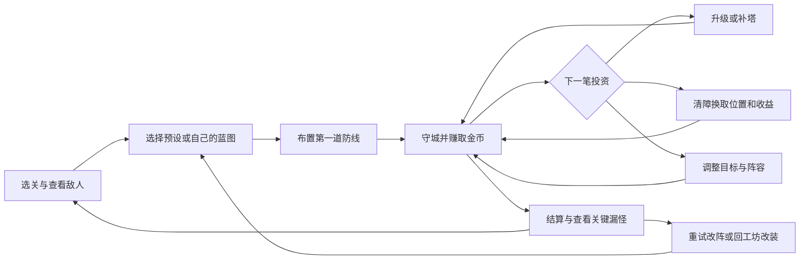

# PRD：Siege 从武器试玩走向可反复挑战的塔防

版本：v0.2 实施版  
日期：2026-10-08  
入口：`/siege/play/` 闯关；`/siege/` 武器工坊  
状态：按“新增路由，新页面实现这个项目”实施 8 关验证版；交付范围与验证见 [林地战役交付说明](../docs/siege-campaign-delivery.md)。可玩性目标仍需玩家试玩验证。

## 1. 产品定位与问题

一句话：**用自己设计的武器布置防线，在清障、升级与守城之间做选择，守住一张不断施压的地图。**

本稿将用户所说的“包围萝卜”理解为《保卫萝卜》。目标是接近该类成熟休闲塔防的决策密度、关卡节奏与操作反馈，同时保留 Siege 的“形状影响功能”。“达到同级可玩性”必须经过玩家试玩验证，功能数量和自动化测试不能直接证明这一点。

### 实现前基线

以下是 PRD 编写时对既有工坊的检查结果，新增战役能力见交付说明：

| 能力 | 当前状态 | 对新玩法的意义 |
| --- | --- | --- |
| 精制炮台与自由绘图 | 两种草稿分别保存，炮管尺寸影响真实性能 | 可作为默认武器与进阶改装基础 |
| 确定性编译 | 根据几何计算墨水、质量、惯量、覆盖与火炮参数 | 保留“设计改变战斗”的依据 |
| 自动追踪与真实碰撞 | Rapier 刚体、炮弹、命中、击退、盾牌耐久 | 可复用物理实现；多武器与路径需要重构 |
| 守城 | 单安装位、固定三波、每波五个敌人、普通与重型两种 | 当前用途是测试武器，缺少布阵与局内经济 |
| 工坊与战斗界面 | 同页展示绘图、设计参数、战斗和实测数据 | 需要新增以地图为中心的闯关界面 |
| 保存 | IndexedDB 草稿、匿名 Go 服务蓝图 | 可复用蓝图所有权；关卡进度与断点尚需设计 |
| 关卡与成长 | 尚无选关、局内建造升级、可清除障碍、星级和解锁 | 是此次产品升级的主体 |
| 声音与倍率 | 检查的 Siege 源码中未见声音系统或二倍速控制 | 需新增，并实测手感与性能 |

PRD 调研阶段只确认了既有页面与战斗启动，没有重新证明此前交付文档中的完整测试结果，也没有取得真实玩家可玩性数据。

### 参照的玩法机制

《保卫萝卜4》官网展示了宝箱、减速炮塔、不同攻击效果、可交互地形与干扰炮塔的敌人。由此提炼的设计判断是：地图、武器和敌人需要互相制造选择，清障收益也应参与守城决策。此处是 Siege 的设计推导，不是照搬该游戏的具体数值、关卡或商业系统。参见[官方玩法展示](https://luobo4.737.com/m/index.html)。

## 2. 目标与首期范围

### 产品目标

1. 新玩家能用预设武器快速进入战斗，并在前两关理解建造、清障与升级。
2. 一局中持续出现可解释的选择：升级老塔或建新塔、打敌人或打障碍、提高伤害或增加控制、守一条路或覆盖两条路。
3. 玩家能看到设计的收益与代价：长炮管覆盖更远，但转向和装填更慢；大锤更重，但攻击间隔更长。
4. 失败后能知道发生了什么，并通过改位置、改阵容或改尺寸改善结果。
5. 通过新地图、组合与挑战目标产生重玩，而不是依赖重复刷数值。

### 待确认的建议默认值

| 决策 | 本稿建议 | 取舍 |
| --- | --- | --- |
| 主玩法 | 塔防为主，绘图与尺寸改装提供真实变化 | 默认蓝图支持直接开玩；创造仍会影响功能 |
| 首期规模 | 1 个主题、8 关、5 类武器、5 类普通敌人、1 个首领 | 先验证组合和节奏，验证后扩成约 24 关 |
| 品质重点 | 策略、节奏优先，同时满足基础视觉与手感门槛 | 每个新增系统都应带来可说明的选择 |
| 主要载体 | 独立 Web 游戏，鼠标与触控 | 桌面和真实手机浏览器都需要验收 |

8 关是验证版本，不是“完整内容量已经达到商业手游”的承诺。若方向成立，首发内容建议扩为 3 个主题、约 24 关；每日挑战在核心关卡稳定后再决定。

## 3. 核心循环与决策

一局正常速度目标 3–5 分钟，教学关 1–2 分钟。关内约 6–10 波，具体时长通过出怪、路径长度和波间节奏共同调节；波数不是单独的验收依据。暂停和工坊时间不计入战斗时长。

每关至少设计三次不同的有效决策窗口，不能把重复点击升级全部算作新决策。例：前期选择清哪个箱子，中期为疾跑怪补控制，后期决定保命还是争取清障星。

### 一局的例子

第 4 关是一张回形路地图。玩家可以先升级入口炮台稳住前两波，也可以把部分火力调去打木箱，提前开放能覆盖两段道路的中心位置。第 3 波出现疾跑怪，长炮管虽然够远，却可能转不过来；玩家需要补一座控制塔，或用更短的炮台守末端。最后一波重甲与群怪混合，中心旋转刃处理群怪，重锤处理重甲。结算显示第 3 波的漏怪与当时投资，玩家重试时能改变自己的决策。

上述组合的有效性属于待验证设计。只有两套不同思路实际通关后，才算该关完成。

## 4. 关卡、地图和波次

### 地图规则

- 俯视 2D，以可读的固定道路和预设安装位为基础。首期不允许玩家堵路或重画路径。
- 每关 6–12 个可用或可解锁安装位，强调弯道、重复覆盖区、入口与末端位置的差异。
- 支持单路线和双入口汇合；每名敌人的路线在出生时确定，界面提前展示路径。
- 障碍占用安装位或作为邻近资源点；装饰与可攻击障碍有明确视觉区别。
- 建造前显示攻击范围、近战扫过区域、价格和适用目标；没有攻击覆盖的位置必须能识别。
- 安装位限制武器尺寸与扫动包络。超限时显示具体原因，不能在部署后偷偷缩小原画或修改性能。
- 道路不是弹丸的障碍；炮台与炮台之间首期不结算友军碰撞。只允许有界的敌人位移，避免场地被永久堵住。

### 波次规则

- 开局由玩家点击“开始进攻”；首波前允许建造和调整，不允许无敌人时无限免费清障。
- 下一波显示入口、敌人类型和数量；新类型首次出现必须提前说明可观察的特性。
- 本波敌人全部处理后进入 5 秒波间准备；玩家可提前启动下一波，首期不为此增加经济奖励。
- 波间允许暂停进入简化改装；返回时保留金币和布阵。关内新部署使用当时冻结的蓝图，已部署武器不会跟着工坊草稿变化。
- 建造、升级、出售与集火在战斗中可操作，也允许玩家暂停后规划。
- 全部波次出场且没有未处理敌人、城堡生命大于零时胜利；城堡生命归零立即失败。
- 击退本身不算击杀。被推出道路的存活敌人应按规则回到合法路径，不能靠离屏删除免费通关；超过位移边界时仍需明确处理结果。

### 8 关内容表

| 关卡 | 核心问题 | 新内容 | 验收重点 |
| --- | --- | --- | --- |
| 1 第一座炮台 | 怎么开始守城 | 默认火炮、建造、一次升级 | 无绘图与 AI 前置步骤，操作中教学 |
| 2 箱子后面 | 守怪还是清障 | 木箱、金币、解锁安装位 | 清箱子有收益，也占用输出时间 |
| 3 跑得太快 | 射程够却没打中怎么办 | 疾跑怪、减速炮 | 可观察追踪与控制的作用 |
| 4 一处两用 | 哪个位置值得投资 | 回形道路、旋转刃 | 中心覆盖收益与外围稳守都可行 |
| 5 铁甲来袭 | 单纯堆火炮为什么吃力 | 重甲怪、重锤 | 有明显克制，仍允许不同通关思路 |
| 6 两头夹击 | 如何分配有限金币 | 双入口、混合波次 | 看得懂下一波，出售重建有用途 |
| 7 贪一点还是稳一点 | 是否抢清宝箱 | 溅射炮、群怪、护旗手 | 投资时机、集火与清障有取舍 |
| 8 林地守门战 | 是否学会组合与调整 | 首领与混合进攻 | 机制预告清楚，两套阵容可通关 |

每关要有独立的路径、障碍布局或波次组合变化。仅换背景、增加血量不能算新关卡。

## 5. 武器、创造与克制

### 五类首期武器

| 武器 | 主要用途 | 明确弱点 | 形状和改装如何影响功能 |
| --- | --- | --- | --- |
| 自动火炮 | 稳定远程单体输出 | 密集群怪、过快转向需求 | 长度与粗细影响射程、弹速、装填、伤害、惯量 |
| 溅射炮 | 打群怪、兼顾清障 | 攻速慢，单体效率低 | 复用炮管几何；使用显式爆破配方和有界效果规则 |
| 减速炮 | 延长其他武器输出窗口 | 自身伤害低，控制有上限 | 使用显式控制配方；炮管仍影响追踪、弹速与射程 |
| 旋转刃 | 弯道与密集近战 | 覆盖有限，对重甲吃力 | 刃长、转轴与质量影响覆盖和实际转速 |
| 重锤 | 重甲、短距离击退 | 慢、短、容易漏快怪 | 锤头大小、臂长与惯量影响命中和冲击 |

溅射与减速是新增能力，当前 `WeaponSpec` 尚不具备这两类配方；必须扩展受限定义和编译规则，不能把它们描述为现有功能。首期盾牌继续保留在工坊实验中，暂不作为战役必须使用的第六类武器。

### 绘图的角色

- 第 1 关用预设蓝图即可开始；玩家不需要会画画，也不需要配置模型。
- 第 3 关后提供一次可跳过的改装引导：同样预算下，把炮管变短，看它更快跟上疾跑怪。
- 战前可选择预设、尺寸改装或已确认的自由绘图蓝图。每关只提供本关允许的武器类别，限制组合数量以建立谜题。
- 原始形状继续进入战场，几何影响继续由编译器产生；不能将画图只变成预制炮台的皮肤。
- 自由绘图需通过当前部件语法、材料与安装位校验。UI 要显示支持的组件，不宣传“任意涂鸦都能用”。
- 元素效果通过玩家明确选择的配方获得；画一个雪花不能让模型私自生成永久冻结能力。
- AI 只帮助提出部件与连接，玩家确认后使用确定性规则；AI 不可用时预设、改装和手动标注都能完成战役。
- 长尺寸、大质量必须带来成本或效率代价。最大尺寸不能在全部关卡成为明显的最佳解。

### 升级与控制规则

- 每座武器有 1–3 级。升级强化效果，几何和类别保持不变；改形状需出售后重新部署。
- 每次升级显示花费与实际参数变化，不只显示笼统的“战力 +X”。
- 首期不做关内升级分支树。先验证位置、类别与尺寸的组合，再增加分支。
- 减速采用最强效果，不叠加；移动速度不得低于基础速度的 50%。普通敌人的击退与眩晕设有单独的冷却窗口。
- 首领保留减速和击退的弱化效果，不得被无限控制；具体系数在首领登场前可查。
- 默认目标是沿路径最接近城堡的可攻击敌人，同进度按稳定 ID 排序。
- 玩家可指定敌人或障碍集火。指令对射程内且可攻击该目标的武器生效，其他武器维持自动防守；取消集火或目标消失时恢复默认。

## 6. 经济与障碍

局内金币用于建造、升级和出售重建；每次重开重置。墨水是蓝图的材料和复杂度预算，不是每发炮弹消耗的资源。首期不增加第三种局内货币。

初始调参方向：开局金币足够建两座基础武器，或建一座并升级一次。具体价格、奖励和敌人生命需联合试玩调整，本文不冻结未经测试的数值表。

- 击杀金币、障碍金币、关卡固定补给均由版本化关卡数据定义；首期不随机掉落金币。
- 建造价格由类别、编译出的性能与材料成本通过版本化规则计算，同输入得到同价格。自绘武器不能绕过定价。
- 出售返还建造与升级已花金币的 70%，向下取整；未确认的建造预览取消不扣钱。
- 暂停时可以规划与购买，但攻击、出怪、装填、控制和金币产出全部冻结。
- 三类障碍：低血量木箱提供少量金币；树桩开放战略安装位；宝箱投入更久但给较大金币收益。奖励提前可查，首期不放随机隐藏炮台。
- 障碍只在明确集火或攻击效果合法覆盖时受伤；物理装饰不参与攻击判定。
- 炮弹只结算一次基础命中；溅射可对范围内多个不同实体各结算一次。
- 战斗启动后的开局弱波才是第一个清障窗口。清障必须与守城共用有限火力，避免把它做成免费的待机操作。
- 金币不足时显示缺多少，安装位不合法时显示原因；失败操作不扣钱。

## 7. 敌人与首领

五类普通敌人以外形、运动和行为区别，首次遇见不依赖阅读长说明：

| 敌人 | 提出的战术问题 | 应对方式 |
| --- | --- | --- |
| 普通兵 | 基础位置和火力是否够 | 默认火炮、基础升级 |
| 疾跑兵 | 追踪速度和末端防守是否够 | 短炮管、减速、保底塔 |
| 重甲兵 | 是否过度依赖轻型远程攻击 | 重锤，或用控制扩大输出窗口 |
| 小群怪 | 单体输出是否来得及切换 | 溅射、旋转刃、覆盖密集路段 |
| 护旗手 | 是否会调整集火目标 | 击败它后，周围敌人的加速效果消失 |

护旗手的范围与增益必须可见。首领只做两段机制：正常推进；生命降到指定阈值时，经过明确预警后召来一组援军。首期不增加破坏炮台、飞行、潜水和随机免疫。

敌人到达城堡按关卡数据扣血并标记为漏怪；漏怪不给击杀金币。被打飞仍存活、在路径外停留、卡住或越界的敌人都必须有有界恢复规则，不能使关卡无限等待或自动算作击杀。

## 8. 操作、画面与声音

### 主界面

- `/siege/play/` 首次进入第一关；后续恢复最近的波间防线，提供选关与工坊入口。`/siege/` 保留创作与单武器测试，并提供闯关链接。
- 战斗占据主要空间。顶部只保留城堡生命、金币、波次、暂停与倍率；底部是本关可用武器。
- 点击安装位后显示建造菜单；点击已有武器显示范围、升级、出售。每次操作最多经过“选位置 → 选动作”两个主要步骤。
- 完整参数、碰撞调试和物理细节放到工坊或显式详情入口；选关与战斗无需读质量和惯量才能操作。
- 暂停、正常速度、二倍速、音效开关可访问。切后台自动暂停，回前台由玩家明确继续。
- 战前／波间工坊支持返回原关卡状态；战斗中不弹出要求实时画图或等待模型的界面。

### 必须交付的反馈

- 开火有炮口、装填和轻微后坐反馈；升级后外观能区别等级。
- 命中有伤害反馈，减速有独立标记，重锤有冲击反馈；关键敌人、路径和安装位始终可辨认。
- 金币入账、障碍破坏、可升级、漏怪、首领预警、胜败分别有短促反馈。
- 声音在首次玩家操作后启用；静音与音量选择持久保存。没有音频时也能理解所有关键事件。
- 城堡是情感反馈点，有完好、受损、失守状态；画面采用统一的纸上林地风格，避免现实纹理背景与扁平 UI 缺少层次。
- 保留减少动态效果设置；关闭震屏和强烈闪光不改变战斗规则。
- 390px 窄屏与桌面无需横向滚动。触控关键命中区至少 44px，并验证相邻安装位不会误触。
- 安装位与主要动作具有键盘可达的语义控制；颜色以外还有图形或文字标记。

## 9. 结算、成长与重玩

- 每关三颗星：通关一颗、城堡未受伤一颗、全部可清障碍在结算前清除一颗；后两颗只在成功通关时授予。
- 保存单次通关获得的最高星数，不把分别完成的条件拼成三颗星。全清不延迟胜利结算，因此需要玩家在最后一波结束前安排火力。
- 首次通关开放下一关；新武器由固定关卡进度解锁，并提供可用的预设蓝图。
- 结算主动作是“下一关”或“重试”；失败时提供“调整蓝图”，保留工坊草稿。
- 失败页展示关键漏怪波次、类型、路线和当时布阵；提示依据实际事件生成，不把未测量的原因写成确定诊断。
- 例如“第 3 波漏过 4 个疾跑兵；末端没有可攻击武器”属于可核实事实。只有记录了追踪或射程数据，才能解释为追踪不足或射程不足。
- 展示阵容、各塔实际伤害和控制效果，但不把伤害排行榜当成唯一评价：控制武器需要显示控制贡献。
- 重试保留本关允许的蓝图选择，不保留金币、敌人或已部署武器等级。
- 首期成长提供新工具和新问题，不通过永久攻击力、广告复活、体力或装备品质拉高通关门槛。

## 10. 用户故事与验收

UI 故事的浏览器验收原采用 PRD 技能要求的 dev-browser 路径；当前会话没有该技能，执行时使用可用的 `cua_repl` 与仓库 Playwright 工具完成同等浏览器验证，不以工具缺失跳过验收。

| ID | 用户故事 | 可验收条件 | 验证层 |
| --- | --- | --- | --- |
| US-01 | 作为新玩家，我能直接玩第一关 | 无账号、绘图或模型前置；预设可建造；教学随操作推进 | 组件与浏览器 |
| US-02 | 作为玩家，我能判断一个位置的价值 | 建造前显示范围、价格、合法性；两段道路覆盖可见 | 浏览器 |
| US-03 | 作为玩家，我能用金币建造并调整防线 | 扣款原子化；升级显示增量；出售按 70% 返还；不足不扣款 | 纯规则与浏览器 |
| US-04 | 作为玩家，我能通过清障扩大选择 | 指定障碍后合法攻击；奖励只发一次；清障位置可建造 | 运行时与浏览器 |
| US-05 | 作为玩家，我能识别下一波压力 | 波次预览与实际内容一致；开始下一波遵循状态机；新敌人提前提示 | 规则与浏览器 |
| US-06 | 作为玩家，我能让远程和近战互相配合 | 同场多座独立武器；每座有独立装填／驱动；命中、控制、伤害无重复结算 | 运行时与浏览器 |
| US-07 | 作为玩家，我能集火危险目标 | 射程内合法武器响应；其余自动守城；取消或目标消失后恢复默认 | 运行时与浏览器 |
| US-08 | 作为玩家，我能把改装带进下一次部署 | 同几何产生同性能与价格；部署快照不随草稿变动；超尺寸明确报错 | 编译规则与浏览器 |
| US-09 | 作为玩家，我能按自己的节奏操作 | 暂停全部规则冻结；二倍速相同指令序列得到相同结局；切后台暂停 | 运行时与浏览器 |
| US-10 | 作为玩家，我能理解输赢和重试 | 最后一个敌人处理后才结算；失败显示真实漏怪事件；重试重置经济 | 规则与浏览器 |
| US-11 | 作为玩家，我能继续未完成的挑战 | 保存最高星数、解锁与蓝图选择；刷新按已完成波次断点恢复 | 存档规则与浏览器 |
| US-12 | 作为触控玩家，我能完成一关 | 真机完成建造、升级、集火、暂停、重试；无横向溢出或安装位误触 | 真实手机浏览器 |

每个故事以一个行为为验收单位；跨度较大的武器、敌人和关卡故事在实施拆分时按类别／关卡细分。代码变更需通过对应 typecheck、lint 和窄范围测试，浏览器验证不能被单测代替。

## 11. 编号功能要求

| 编号 | 要求 | 优先级 |
| --- | --- | --- |
| FR-01 | `/siege/play/` 提供首次开玩、选关、继续和工坊链接 | 首期必需 |
| FR-02 | 地图定义道路、入口、城堡、安装位、可攻击障碍与装饰 | 首期必需 |
| FR-03 | 多武器部署与单一战斗世界，支持独立升级和出售 | 首期必需 |
| FR-04 | 金币与版本化定价，禁止重复发奖或透支建造 | 首期必需 |
| FR-05 | 配置化波次、预览、波间准备与显式胜败状态机 | 首期必需 |
| FR-06 | 集火、清障、解锁安装位和明确取消 | 首期必需 |
| FR-07 | 五类武器、五类普通敌人、一个首领及有界控制规则 | 首期完整验证版 |
| FR-08 | 预设、改装、自绘蓝图进入同一验证与部署流程 | 首期必需 |
| FR-09 | 暂停、二倍速、后台暂停、基础声音和战斗反馈 | 首期必需 |
| FR-10 | 8 关、星级、固定解锁、下一关与重试 | 首期完整验证版 |
| FR-11 | 漏怪事实、布阵快照和可解释的结算提示 | 首期必需 |
| FR-12 | 本地进度、波间断点、设置保存与失败重试 | 首期必需 |
| FR-13 | 战斗数据导出供受控试玩分析，不自动发布或外传 | 验证必需 |
| FR-14 | 更多主题、每日固定挑战、分享阵容 | 核心验证后再定 |

## 12. 工程边界与性能

### 复用与必须新增的能力

- 保持独立 `apps/siege`、`packages/core/siege`、`server/internal/siege` 与 `/siege/`，不接入 Auro 登录、工作区或 PostgreSQL。
- 复用 Drawing／Spec、几何编译、炮台生成与绘制、现有素材和匿名蓝图保存。已有 P0 工坊作为测试与创作入口继续使用。
- core 增加关卡定义、金币／升级／星级规则、战斗指令校验、受限配方和版本化定价；保持纯逻辑，不导入 DOM 或 Rapier。
- app 运行时把当前单个 `definition/body/mount` 改为武器实例集合；继续使用一个物理世界，增加路径推进、障碍与事件记录。不是把现有三波常量简单加大。
- 关卡使用可校验的版本化配置，定义路径、安装位、经济、武器列表、敌人配方与波次。首期由开发维护配置，不建设通用关卡编辑器。
- 新增效果和保存契约需经过 schema 校验、异常响应测试与明确版本处理；不增加隐藏的旧规则执行适配。
- 草稿、关卡进度和偏好通过 app 层 `StorageAdapter`／IndexedDB 保存。首期蓝图继续使用既有服务；不假称本地进度已经跨设备同步。

### 断点与可重复性

- 波间敌人全部处理完后保存关卡版本、蓝图快照、武器位置与等级、金币、城堡生命、已清障碍和下一波。
- 刷新恢复到最近完成波次后的检查点，不保存物理世界中途瞬间；进入待开始状态，提示具体波次。
- 同一波失败或刷新重开不重复保留该波金币；记录关卡、规则与蓝图版本，版本不同不得悄悄按旧结果执行。
- 规则变更后保留历史星级与原画，但不能恢复不兼容的战斗检查点；显示原因并提供从该关开局重试。
- 同版本、同初始数据、同逻辑 tick 指令顺序在支持的验证环境中应产生一致结果。公开排行榜的可信性不属于本地确定性的证明范围。

### 性能目标

- 压力场景先定为 12 座武器、40 个敌人、96 发在场炮弹与完整障碍。达到资源上限时的行为要可见且有界；不能悄悄少出敌人或少结算伤害。
- 桌面正常速度争取稳定 60 FPS，指定中档手机正常速度不低于 30 FPS；二倍速需单独验证仿真能跟上，不能仅快放动画。
- 在指定设备、浏览器和网络条件下记录首次可操作时长。目标：缓存后 2 秒内进入可操作战斗，首次冷启动 5 秒内；这是待实测门槛，不是当前成绩。
- WASM 和美术资源加载阶段显示状态；关键资源不可用时保留进度并允许重试。模型请求不参与战斗加载。
- 测量设备型号、分辨率、浏览器、FPS 分位数和逻辑步进积压；不能用开发机体感替代手机性能报告。

## 13. 非目标

首期不做原生 App、多人对战、可信排行榜、公开作品市场、无限任意组件组合、侧视重力模拟、材料断裂、玩家堵路寻路、账号系统、跨设备同步、付费战力、广告复活、体力、随机卡包与通用游戏平台。

上述范围在核心验证通过后分别评估。首期仍需完成本文明确列出的触控、声音、反馈与重玩闭环，不能因“验证版”跳过这些品质要求。

## 14. 成功标准与试玩方法

以下均为建议的决策门槛，尚无真实测试基线，不是《保卫萝卜》的已知指标。

先邀请 12 名目标玩家，其中至少 6 名近期没有玩过 Siege；包含休闲塔防熟悉者和不熟悉者。固定同一版本，在不代操作、不口头教解法的条件下测试前 4 关，再自由试玩后 4 关。小样本用于发现问题和决定是否继续，不用于推断市场留存。

| 指标 | 建议门槛 | 统计口径 |
| --- | --- | --- |
| 首次开玩 | 至少 10/12 人在 60 秒内进入有效战斗 | 从页面可操作到自己建造且命中首敌；不含研究者代操作 |
| 规则理解 | 至少 10/12 人无需口头帮助完成建造、升级、清障 | 以实际操作记录计数 |
| 自发继续 | 至少 8/12 人在第一关后主动进入下一关 | 不通过研究者催促 |
| 失败可解释 | 有自然失败者中至少 70% 能说出一个有效调整 | 按实际失败人数报告分子和分母；不足 5 人时增加挑战关样本，暂不判定 |
| 自发重试 | 有自然失败者中至少 60% 主动重试 | 按实际失败人数报告分子和分母 |
| 创造有意义 | 至少 8/12 人能预测一次改装的收益与代价 | 再观察战斗确认理解；只觉得外观变了不算 |
| 有效策略 | 每关至少两套不同阵容或投资顺序可通关 | 不同尺寸的同一万能阵容不自动算两套 |
| 控制支配风险 | 单一最大尺寸武器无调整通吃 8 关即不达标 | 用极端设计组合实际跑关 |
| 体验质量 | “愿意自己继续玩”回答达到 8/12，记录原话和退出原因 | 与实际继续行为一起判断 |
| 手机体验 | 两款明确型号真机完成整局与压力场景 | 报告实际触控、帧率、加载和声音结果 |

试玩记录包括：开始／结束关卡、建造升级出售、集火和清障、漏怪、暂停、改装、重试、下一关。无需采集原始涂鸦或个人身份即可分析上述问题。首期在本地收集与导出测试记录；使用外部分析服务前再明确采集范围。

“可玩性达到参照级别”暂不作为一个可勾选的最终事实。完成 8 关后安排同一批玩家体验参照游戏与 Siege，以可理解性、选择质量、反馈和重玩意愿进行对照访谈，再决定扩展或返工。

## 15. 交付阶段与停止条件

| 阶段 | 交付物 | 进入下一阶段的条件 |
| --- | --- | --- |
| A 核心战斗 | 1 张地图、3 类武器、建造升级、经济、清障、暂停、输赢、基础音画 | 两套策略通关；存在真实清障取舍；手机可操作 |
| B 完整验证版 | 8 关、5 类武器、完整敌人、首领、选关解锁、星级、断点、结算反馈 | 全部功能验收与设备门槛通过 |
| C 可玩性调优 | 受控试玩、调数值、改地图、修反馈 | 产品指标达到建议门槛，或与用户共同调整门槛 |
| D 首发扩展 | 3 主题约 24 关，按结果评估挑战与分享 | 核心验证成立；新增关卡引入新的战术问题 |

不在未知制作资源、真机表现和玩法验证结果时承诺日历排期。若 A 阶段仍是“放完塔等结束”，先改经济、地图和波次；若画图只造成操作负担，调整创造入口和语法；若全部关卡都用一种阵容碾压，先修克制与定价。此时不通过增加关卡数量掩盖问题。

## 16. 讨论事项

1. 主体验选哪个：A 塔防为主＋真实创造；B 武器物理实验为主＋守城验证；C 标准塔防。本稿建议 A。若选 B，应改为城墙多安装位和来袭扇区，绘图次数与实验乐趣成为主要目标，不能只换首页文案。
2. 首个落地版本选哪个：A 6–8 关验证版；B 20–30 关首发；C 一关先达到品质。本稿建议最终验收 8 关，但先按阶段 A 打磨一关再扩展。
3. 首要质量目标选哪个：A 策略与节奏；B 美术音效与手感；C 内容量与长期成长。本稿建议 A，同时设置 B 的最低交付门槛。
4. 希望玩家的创造占体验多少：预设直接玩，想优化再改装；还是每关都必须创造？本稿建议前者，让创造由战术问题触发。
5. 手机竖屏与横屏哪个是主目标、可用于真机验收的设备是什么？在确认前，以桌面和 390px 竖屏可操作为设计约束。

## 17. 依据与验证说明

- [现有交付与边界](../docs/doodle-siege-delivery.md)
- [原始产品构想](../docs/画武器对战20261007.md)
- [架构设计](../docs/doodle-siege-architecture.md)
- [现有工坊与入口](../apps/siege/src/app.tsx)
- [单武器战斗运行时](../apps/siege/src/runtime/engine.ts)
- [三波与统计规则](../packages/core/siege/simulation.ts)
- [武器编译器](../packages/core/siege/compiler.ts)
- [蓝图与草稿契约](../packages/core/siege/schema.ts)
- [浏览器存储](../apps/siege/src/platform/storage.ts)
- [既有浏览器用例](../e2e/siege/siege.spec.ts)

仓库指令引用的两份 `apps/docs/.../conventions*.mdx` 在本次 checkout 中不存在；本稿沿用既有“城堡、炮台、蓝图、墨水”等术语及根指令中的文案规则。当前目录也没有 Git 元数据，因此不能用 `git diff --check` 或提交状态作交付证据。本文仅新增 PRD；没有改动玩法代码，没有运行代码测试或发布服务。
